# AI Social Media SaaS — System Architecture

| Field | Value |
|---|---|
| Document status | Approved architecture baseline for implementation planning |
| Version | 1.0 |
| Prepared | 29 October 2026 |
| Product authority | `PRODUCT_OVERVIEW.md` and `docs/PRODUCT_REQUIREMENTS.md` |
| Technology authority | `docs/TECH_STACK.md` |
| Initial social channels | LinkedIn and Instagram |
| Architecture style | FastAPI modular monolith with separate Celery workers |
| Deployment target | Single AWS EC2 host using Docker Compose |

> This document defines the V1 system architecture. It describes modules, interfaces, data ownership, flows, failure handling, deployment, and implementation seams. It does not contain application code. Provider behavior marked “integration verification required” must be proven against the configured account before the affected capability is considered complete.

---

## 1. Architecture objectives

The system must let multiple users independently authenticate, receive one private workspace, configure one brand profile, generate AI-assisted campaigns, review and version individual posts, approve exact publishable versions, and schedule approved LinkedIn or Instagram content through Zernio.

The architecture optimizes for:

1. strict workspace isolation;
2. deterministic approval and publishing controls;
3. retry-safe long-running AI work;
4. explicit provider seams;
5. durable and explainable state;
6. a deployment an individual engineer can operate and describe;
7. low initial infrastructure complexity;
8. clear paths for recovery without speculative microservices.

### 1.1 Non-negotiable invariants

- One authenticated application user owns exactly one V1 workspace.
- Workspace ownership is derived and enforced by FastAPI, never trusted from the browser.
- Every private record, task, asset, provider mapping, and workflow resolves to one workspace.
- Approval applies to one immutable publishable-content version.
- Scheduled content cannot be edited in place: **unschedule → edit → reapprove → reschedule**.
- Only a currently approved version may be submitted to Zernio.
- Failed publication is retried only after an explicit user action.
- A repeated webhook delivery never authorizes another publishing attempt.
- A campaign can have at most two provider-started AI image generations, including regenerations.
- Zernio owns scheduled execution; Celery does not wake up to publish scheduled social posts.
- PostgreSQL is the durable source of truth for application and workflow state.
- Redis is task transport and a Celery result backend, not the product-state authority.
- Already published social posts are not removed when the application account is deleted.

---

## 2. Architecture decision status

| Decision | V1 architecture |
|---|---|
| Scheduled-post editing | Successfully unschedule first, then edit, reapprove, and reschedule |
| Initial social platforms | LinkedIn and Instagram |
| Failed publication | Manual retry only |
| Approval invalidation | Immutable publishable-content versioning |
| AI image budget | Two provider-started generations per campaign |
| Authentication | Short-lived Neon Auth JWT validated with JWKS |
| Workflow persistence | PostgreSQL-backed LangGraph checkpoints |
| Media delivery | Private S3 storage followed by Zernio-supported media upload/handoff |
| Web-image rights | Source/license checks plus explicit human confirmation |
| Data retention | Immediate revocation, 30-day soft deletion, primary purge after 30 days, backup expiry target within 35 days |
| Data export | Basic structured workspace data plus owned media before deletion |
| Secrets | AWS-managed secret storage; AWS Secrets Manager is the recommended implementation |
| Recovery | Backups and explicit recovery objectives, verified by restore exercises |

### 2.1 Items requiring integration verification

- Neon Auth JWT claims, JWKS URL, issuer, audience, rotation, session revocation, and OAuth behavior.
- AI Credits model identifiers, structured output, image endpoint, rate limits, and provider-start evidence.
- Tavily request limits, response/source metadata, and production error behavior.
- Zernio LinkedIn and Instagram connection, media, scheduling, cancellation, retry, and partial-result behavior.
- Zernio media upload from private S3-backed application assets.
- Neon backup retention/restore and AWS retention capabilities needed for the 35-day expiry target.
- Exact EC2 capacity, Redis persistence, Celery concurrency, and deployment recovery settings.

---

## 3. System context

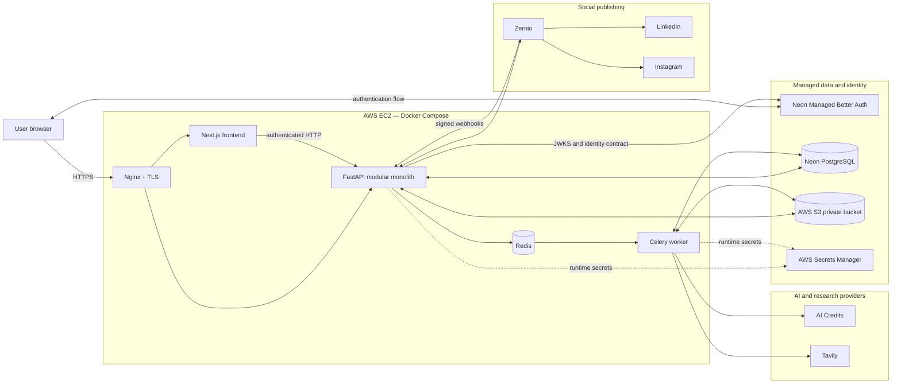

### 3.1 Trust model

| Area | Trust rule |
|---|---|
| Browser | Untrusted client; identifiers and state flags are claims, not authorization facts |
| FastAPI | Application authorization and deterministic business-rule authority |
| PostgreSQL | Durable application, workflow, approval, budget, and publishing authority |
| Celery task | Potentially duplicated or stale; must reload and revalidate state |
| Redis | Private transport; never sole evidence of completion or authorization |
| LangGraph/model | Reasoning mechanism; cannot authorize, approve, or publish |
| Tavily result | Untrusted external content; may contain prompt injection or inaccurate claims |
| S3 object key | Storage locator; never sufficient evidence of workspace ownership |
| Zernio identifier/webhook | Provider routing data; verify signature, mapping, and workspace relationship |

---

## 4. Architectural style: deep modules in a modular monolith

The backend is one FastAPI deployment. It is divided into deep modules with small interfaces. A module owns its invariants, transactions, provider translation, and failure semantics. HTTP routes and Celery entry points call module interfaces rather than duplicating logic.

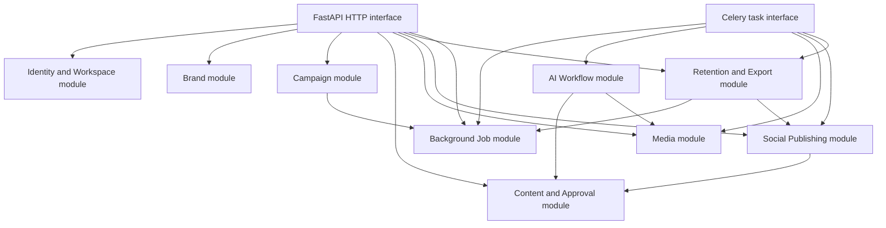

### 4.1 Module interfaces

The following are conceptual interfaces, not language-level definitions.

| Module | Small external interface | Complexity hidden inside |
|---|---|---|
| Identity and Workspace | Resolve authenticated workspace; provision first workspace; disable/restore account | JWT/JWKS, identity mapping, races, workspace uniqueness, status checks |
| Brand | Read/update profile; resolve campaign brand context | ownership, validation, saved values versus overrides |
| Campaign | Create campaign; start/retry generation; read campaign | transactions, job creation, lifecycle, progress aggregation |
| Content and Approval | Create revision; approve version; evaluate publishability | versioning, material changes, approval validity, state transitions |
| Media | Initiate upload; request AI image; confirm web-image rights; authorize access | S3, provenance, slot reservation, validation, rights state |
| Background Job | Create/dispatch; claim; report progress; complete/fail/cancel; recover | PostgreSQL-to-Redis gap, retries, leases, cancellation, stale jobs |
| AI Workflow | Generate campaign; revise one post; resume workflow | LangGraph, checkpoints, models, tools, sources, structured output |
| Social Publishing | Connect account; schedule; unschedule; retry failed; ingest provider event | Zernio profiles, idempotency, cancellation, webhooks, reconciliation |
| Retention and Export | Build export; initiate deletion; restore; purge eligible account | revocation, cancellation, soft deletion, S3 purge, legal exceptions |

### 4.2 External seams and adapters

True external dependencies are injected through interfaces. Production uses the real adapter; tests use a fake or mock adapter.

| Seam | Production adapter | Test adapter |
|---|---|---|
| Identity token verification | Neon Auth JWKS adapter | Signed-test-token/fake identity adapter |
| Model gateway | AI Credits adapter | Deterministic model adapter |
| Research | Tavily adapter | Fixture research adapter |
| Object storage | AWS S3 adapter | In-memory/local fake object store |
| Social publishing | Zernio adapter | Stateful fake social publisher |
| Background dispatch | Celery/Redis adapter | Synchronous or recorded task adapter |
| Clock | System UTC clock | Controllable test clock |

Provider-specific request and response structures must stop at the adapter. Domain modules use application-owned commands, results, errors, and state names.

---

## 5. Repository and project organization

Recommended structure:

```text
ai-social-media-saas/
├── AGENTS.md
├── README.md
├── PRODUCT_OVERVIEW.md
├── docs/
│   ├── PRODUCT_REQUIREMENTS.md
│   ├── TECH_STACK.md
│   └── ARCHITECTURE.md
├── frontend/
│   ├── app/                         # Next.js App Router routes/layouts
│   ├── components/                  # shared UI composition
│   ├── features/                    # product-area UI and client coordination
│   │   ├── auth/
│   │   ├── brand/
│   │   ├── campaigns/
│   │   ├── content-review/
│   │   ├── calendar/
│   │   ├── connections/
│   │   └── settings/
│   ├── lib/                         # typed HTTP client, session helpers, utilities
│   ├── public/
│   └── tests/
├── backend/
│   ├── src/
│   │   └── social_saas/
│   │       ├── main.py              # FastAPI composition root
│   │       ├── config.py
│   │       ├── identity/
│   │       ├── workspaces/
│   │       ├── brands/
│   │       ├── campaigns/
│   │       ├── content/
│   │       ├── media/
│   │       ├── jobs/
│   │       ├── ai/
│   │       ├── social/
│   │       ├── retention/
│   │       └── platform/            # database, errors, logging, health
│   ├── migrations/                  # Alembic
│   └── tests/
│       ├── unit/
│       ├── integration/
│       ├── security/
│       ├── contract/
│       └── end_to_end/
├── infra/
│   ├── docker/
│   ├── nginx/
│   ├── compose/
│   └── scripts/                     # controlled deployment/operations scripts
├── .github/
│   └── workflows/
└── docker-compose.yml
```

### 5.1 Organization rules

- Route modules translate HTTP to application commands; they do not contain domain logic.
- Celery task entry points are thin and call the same module interfaces as HTTP routes.
- SQLAlchemy persistence stays inside the owning module or shared platform persistence utilities.
- Cross-module access uses an owning module's interface, not direct table mutation.
- Provider adapters live with the module that owns the provider relationship.
- LangGraph node implementations live within the AI module; they call content/media interfaces rather than writing those tables directly.
- Tests primarily assert behavior through module interfaces. Internal seams exist only where they provide real test or provider substitution value.

---

## 6. Authentication and workspace authorization

### 6.1 Authentication flow

V1 supports Neon Auth email/password signup and login plus Google OAuth. Email verification, password reset, session expiry, and logout use Neon Auth's documented flows; FastAPI independently verifies the resulting short-lived token and application account status.

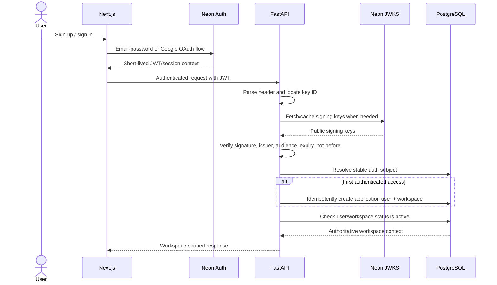

### 6.2 JWT validation

FastAPI validates:

- allowed signing algorithm;
- signature against a trusted JWKS key;
- key identifier and rotation behavior;
- expected issuer;
- expected audience;
- expiration and not-before claims;
- stable subject/identity claim;
- required authentication context defined by Neon Auth.

JWKS keys may be cached with bounded lifetime. Unknown keys trigger a controlled refresh. Failure to obtain or validate keys fails closed for protected operations.

### 6.3 Revocation and immediate account blocking

A short-lived JWT may remain cryptographically valid after provider-side revocation. Therefore every authenticated application request also checks application user/workspace status. When deletion begins, the account is marked `deletion_pending` or equivalent in PostgreSQL, causing immediate authorization denial even if an old JWT has not expired.

The deletion workflow also requests Neon session revocation using the provider-supported mechanism. Application-status enforcement is the immediate local guarantee; provider revocation is defense in depth and must be integration-tested.

### 6.4 Idempotent workspace provisioning

Required constraints and behavior:

- `application_users.auth_subject` is unique.
- `workspaces.owner_user_id` is unique for V1.
- provisioning executes within a transaction.
- concurrent first requests resolve to the same user/workspace.
- OAuth callback retries do not create additional workspaces.
- provisioning failure exposes no partial workspace as usable.

### 6.5 Authorization context

After authentication, FastAPI creates an internal context containing the application user, workspace, account status, and correlation information. Domain operations accept this trusted context rather than a caller-supplied workspace identity.

For any resource lookup, the effective predicate is conceptually:

```text
resource.id = requested_id
AND resource.workspace_id = authenticated_workspace_id
AND workspace.status = active
```

Return a non-disclosing not-found/unauthorized response consistently so a caller cannot confirm another workspace's identifiers.

---

## 7. Logical database architecture

### 7.1 Entity relationship diagram

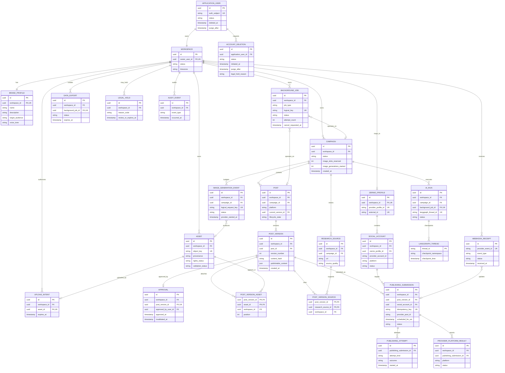

This diagram is logical. Exact column names, JSON decomposition, enum implementation, and audit fields are detailed-design decisions.

### 7.2 Primary-key and ownership rules

- Use server-generated opaque identifiers, recommended UUIDs.
- Every workspace-owned table stores `workspace_id` directly where doing so prevents ambiguous or expensive authorization joins.
- Child records also retain their natural parent foreign key.
- Foreign-key relationships must prevent associating a child with a parent from another workspace. This may use composite foreign keys, validated application transactions, or both.
- Provider IDs are never primary authorization keys.
- Authentication subject is unique and stable; email is not an authorization key.

### 7.3 Tenant-local uniqueness

Examples:

- one brand profile per workspace;
- one Zernio profile per workspace;
- one post version number per post;
- one provider account mapping per workspace/provider account;
- one logical background job per idempotent operation;
- one logical AI generation request per image event;
- one stable webhook event ID per environment/integration.

### 7.4 Transactions and concurrency

Use explicit SQLAlchemy 2.x transactions. External calls occur outside long-held database transactions.

Concurrency-sensitive operations:

| Operation | Required control |
|---|---|
| Workspace provisioning | Unique constraints plus transactional upsert/retry |
| Image-slot reservation | Row lock or atomic conditional update |
| Job claim | Atomic state transition with attempt/lease information |
| Post version creation | Lock/current-version check and monotonically increasing version |
| Approval | Verify version is current and eligible in same transaction |
| Schedule submission | Persist immutable intent/idempotency key before provider call |
| Webhook receipt | Unique provider event ID insert before applying effect |
| Account purge | Idempotent per-resource deletion with durable purge state |

### 7.5 Indexing strategy

Initial indexes should cover:

- `application_users(auth_subject)` unique;
- `workspaces(owner_user_id)` unique;
- workspace plus created/status filters for campaigns, posts, jobs, assets, and submissions;
- `posts(campaign_id, lifecycle_state)`;
- `post_versions(post_id, version_number)` unique;
- `approvals(post_version_id)`;
- `background_jobs(status, created_at)` for recovery;
- `publishing_submissions(provider_post_id)` where present;
- `publishing_submissions(workspace_id, status, scheduled_for_utc)`;
- `webhook_receipts(provider_event_id)` unique;
- deletion requests by `status` and `purge_after`;
- data exports by workspace/status/expiry.

Indexes must be validated using actual query plans rather than added speculatively.

### 7.6 Alembic strategy

- Application schema changes require Alembic revisions.
- LangGraph checkpointer tables use a reviewed migration/setup path compatible with deployment; they are not silently created by every worker.
- One controlled deployment step runs migrations.
- Prefer backward-compatible expand/migrate/contract changes when a deployment spans old and new processes.
- Destructive migrations require backup verification and a roll-forward recovery plan.
- Neon Auth-managed schema is not modified by application Alembic migrations unless official integration instructions explicitly require it.

---

## 8. Post versioning and approval architecture

### 8.1 Publishable-content version

A `POST_VERSION` is an immutable snapshot of everything that can change the public result or its destination-specific rendering. At minimum it includes:

- target platform;
- caption/body text;
- hashtags included in the published text or fields;
- selected media asset references and order;
- applicable platform-specific options;
- source/claim snapshot where required for review;
- a deterministic content hash of the canonical publishable representation.

Schedule time is operational metadata rather than content, but changing destination account or platform creates a new publishable version or invalidates the existing approval because it changes the publication context.

### 8.2 Approval flow

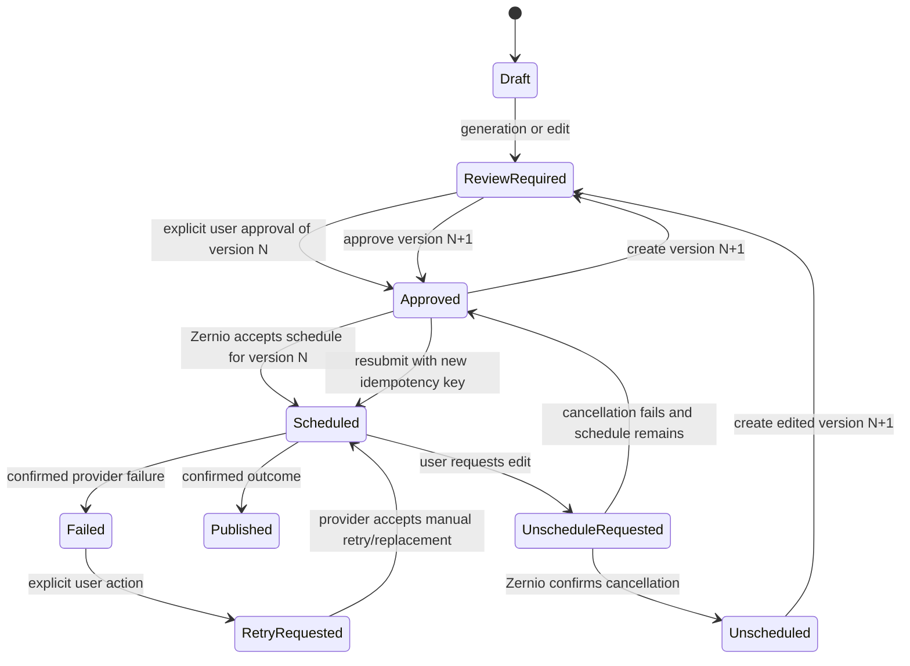

### 8.3 Editing a scheduled post

1. User requests unschedule.
2. FastAPI verifies ownership and current submission state.
3. Social Publishing module sends the cancellation request to Zernio.
4. Post enters `unschedule_requested`; editing remains blocked.
5. Only after cancellation is confirmed does the post become `unscheduled`.
6. User edits, creating a new immutable version.
7. Previous approval does not apply to the new version.
8. User explicitly approves the new version.
9. A new publishing submission and idempotency key are created.

If cancellation fails because publishing already began or completed, the original scheduled/published version remains immutable. The user may create a separate future post; the application must not pretend the original was changed.

#### 8.3.1 Schedule-only changes

A schedule-only change modifies the intended publication time/timezone without changing the approved publishable-content version, platform, or destination account. It does not invalidate approval.

- FastAPI verifies that the same version is still current and approved.
- If Zernio supports an integration-tested reschedule operation for the post state, the Social Publishing module updates the provider schedule and records an attempt.
- If direct rescheduling is unavailable or unsafe, the module cancels the existing provider schedule and creates a replacement submission for the same approved version with a new local submission identity and new Zernio idempotency key.
- The post remains protected from content editing throughout a schedule-only operation.
- Changing platform, destination account, text, hashtags, media, media order, or platform-specific publishable options is not schedule-only and requires a new version and approval.
- Concurrent schedule changes use optimistic version/state checks; one succeeds and stale requests receive a conflict response.

### 8.4 Manual retry

- A failed outcome is visible with a normalized safe reason.
- No automatic failed-post publishing retry occurs.
- An authenticated user explicitly requests retry.
- FastAPI verifies that the exact version remains approved and the destination remains connected.
- The adapter uses the verified Zernio failed-post retry capability or creates a controlled replacement according to integration-tested semantics.
- The action creates a durable attempt record.
- Webhook redelivery never enters this flow.

---

## 9. AI image budget and media architecture

### 9.1 Provider-started budget semantics

Only a generation that the provider actually starts permanently consumes one of the two campaign slots. Concurrency still must prevent three provider starts.

Use a reservation state machine:

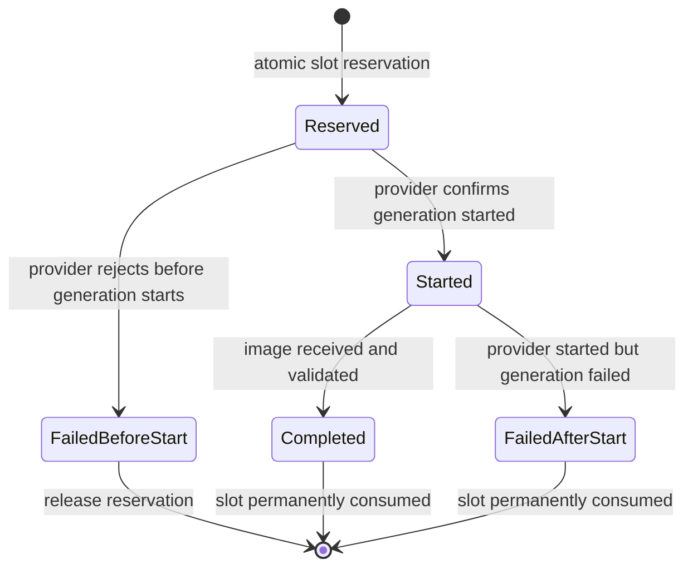

The atomic rule is:

```text
active reservations + provider-started events <= 2 per campaign
```

Flow:

1. lock campaign budget state;
2. reject if two slots are reserved/started;
3. create a unique reserved event;
4. call the provider outside the transaction;
5. mark `started` only when provider evidence confirms start;
6. release the reservation if the provider definitively rejects before start;
7. if the response is ambiguous, keep the reservation and reconcile before releasing or retrying;
8. Celery redelivery reuses the same logical event and reservation.

### 9.2 Asset states

Each asset stores:

- workspace ownership;
- provenance: user upload, AI generated, or web discovered;
- S3 object key when owned media is stored;
- validation status;
- rights state;
- source and license evidence for web-discovered media;
- human confirmation identity/time where required;
- publishability state;
- deletion lifecycle.

### 9.3 User uploads

Recommended upload flow:

1. FastAPI authenticates workspace and creates an upload intent.
2. A short-lived S3 presigned upload is returned or the backend streams the upload, according to detailed design.
3. Client uploads only to the allocated object key.
4. Background processing validates file type, size, dimensions, and integrity.
5. Asset remains unusable for publishing until validation succeeds.
6. FastAPI authorizes every subsequent preview/download URL.

Allowed formats, sizes, scanning, and moderation require final implementation limits.

### 9.4 Web-discovered images

A web image becomes publishable only after:

1. source URL is retained;
2. license or usage terms are captured where available;
3. the system determines the evidence meets the selected policy;
4. the user explicitly confirms they have reviewed and accept the usage conditions;
5. the asset passes technical validation and is associated with the current workspace.

Unclear rights keep the image in reference-only state.

### 9.5 S3-to-Zernio handoff

Owned media remains private in S3. The Social Publishing module uses Zernio's integration-tested media-upload mechanism. If Zernio retrieves a presigned URL, issue a purpose-specific URL long enough for provider ingestion but not permanent public access. Persist provider media references when Zernio returns them.

The application must not assume that a private S3 URL, public object URL, or one platform's media reference works for another platform.

---

## 10. Campaign and AI workflow architecture

### 10.1 Campaign submission

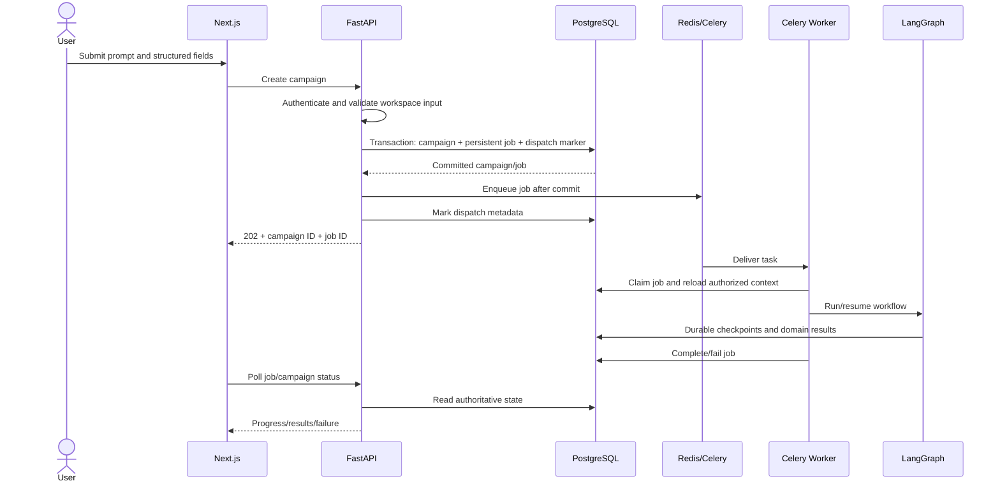

V1 uses polling for job progress unless implementation testing demonstrates a strong need for another transport. WebSockets or an additional real-time service are not required.

### 10.2 LangGraph workflow

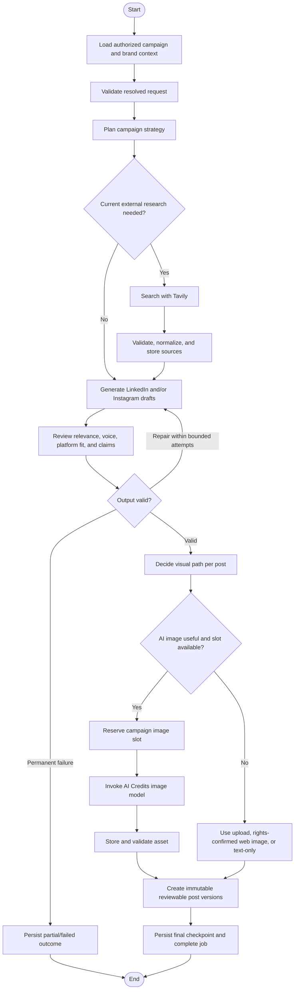

### 10.3 Agent responsibilities

| Logical role | Graph responsibility |
|---|---|
| Master/Orchestrator | Resolve goal, create strategy, route explicit graph branches |
| Research | Decide search queries, call Tavily, normalize and retain references |
| Content Writer | Produce platform-specific LinkedIn/Instagram structured drafts |
| Review | Detect unsupported claims, brand mismatch, incoherence, and schema issues |
| Visual capability | Recommend no image/upload/web suggestion/AI generation and invoke budget gate |

These are graph responsibilities, not necessarily separate LLM instances.

### 10.4 Graph state

Typed graph state should contain references and bounded working data:

- workspace, campaign, run, and job identifiers;
- resolved brand/campaign context snapshot;
- selected platforms;
- strategy draft;
- research decision and source identifiers;
- structured post candidates;
- review results and bounded repair count;
- image logical request identifiers;
- current node/status and safe error information.

Do not place service credentials, social tokens, or unrestricted full database objects in graph state.

### 10.5 PostgreSQL checkpoints

- Use the supported LangGraph PostgreSQL checkpointer.
- Assign each AI run a unique thread/run identity linked to workspace, campaign, and persistent job.
- Checkpoint configuration is created server-side; the client cannot select another workspace's thread.
- Resumption reloads and verifies the application job and campaign before continuing.
- Domain records remain authoritative; checkpoint data supports workflow resumption and debugging.
- Checkpoints follow the workspace/account retention lifecycle and are purged with the account unless a documented legal exception applies.
- Checkpoint schema setup is controlled through deployment/migration procedures.

### 10.6 Model and tool safety

- Structured outputs use Pydantic-compatible schemas.
- Tool calls are explicitly allowlisted.
- Tool parameters are validated and workspace context is injected server-side.
- Tavily output is delimited and treated as untrusted data.
- Models cannot call Zernio publishing operations.
- Models cannot write approval, budget, authorization, or deletion state.
- Repair and provider retries are bounded.
- Usage and latency are recorded without logging unnecessary private prompts.

---

## 11. Background-job architecture

### 11.1 Job lifecycle

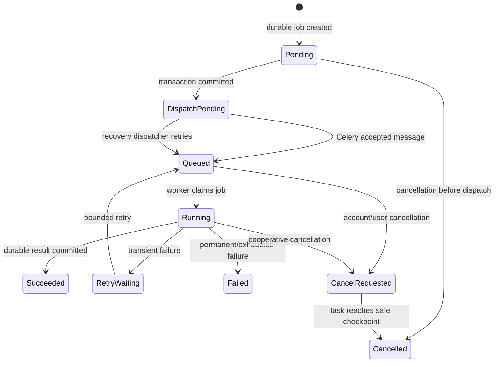

### 11.2 PostgreSQL-to-Redis dispatch

The application must close the crash window between database commit and queue publish without adding a new broker.

Recommended pattern:

1. create the domain record, job, and `dispatch_pending` marker in one PostgreSQL transaction;
2. commit;
3. enqueue the Celery task;
4. mark dispatch metadata;
5. a recovery process finds stale `dispatch_pending` jobs and republishes them using the same logical job identity.

Duplicate dispatch is safe because job claim and task behavior are idempotent.

The recovery trigger can run during process startup and through a lightweight periodic operational task. Celery Beat is not used for social scheduling; if used for dispatch recovery, that is an operational concern only.

### 11.3 Worker execution

Workers receive minimal identifiers. They must:

1. load the job from PostgreSQL;
2. verify workspace/resource relationships;
3. stop if account/workspace is inactive or deletion has begun;
4. atomically claim or resume the job;
5. load current server-side configuration and provider credentials;
6. perform bounded work;
7. persist progress before externally visible side effects where possible;
8. commit final status or safe failure;
9. acknowledge according to configured Celery semantics.

### 11.4 Cancellation

Celery revocation alone is insufficient. Account deletion and user cancellation set durable `cancel_requested_at`/state. Long workflows check cancellation between graph nodes and before provider calls. Already running external calls may finish; their results are stored or discarded according to the job/account state without reactivating access.

### 11.5 Retry domains

| Retry domain | Mechanism | Must not imply |
|---|---|---|
| Celery task | Bounded application retry | A second logical job or paid side effect |
| AI Credits call | Provider-specific bounded retry | A new image slot for the same logical request |
| Tavily call | Bounded transient retry | Unlimited research or unsupported claims |
| Zernio create-post | Same stored idempotency key and reconciliation | A different post version |
| Zernio webhook delivery | Stable event ID deduplication | Republishing a failed post |
| Failed publication | Explicit authenticated user action | Automatic retry from a worker/webhook |

### 11.6 Redis failure

Redis loss may delay or redeliver work but cannot erase durable product intent. Recovery scans PostgreSQL for queued/running jobs whose heartbeat/lease is stale and reconciles them before redispatch. Exact Redis persistence, acknowledgement, visibility, prefetch, and worker concurrency settings require failure testing.

---

## 12. Zernio publishing architecture

### 12.1 Tenant mapping

```text
Application workspace
    1 ─── 1 Zernio profile
                ├── LinkedIn account(s)
                └── Instagram account(s)
```

Use the opaque application workspace ID as the Zernio profile `externalId`. Store the returned `profileId` in PostgreSQL. When connecting or listing accounts, always use the stored workspace profile mapping.

FastAPI must verify that a selected provider account is stored under the authenticated workspace's Zernio profile. Browser-supplied `profileId` or `accountId` is never sufficient authorization.

### 12.2 Account connection flow

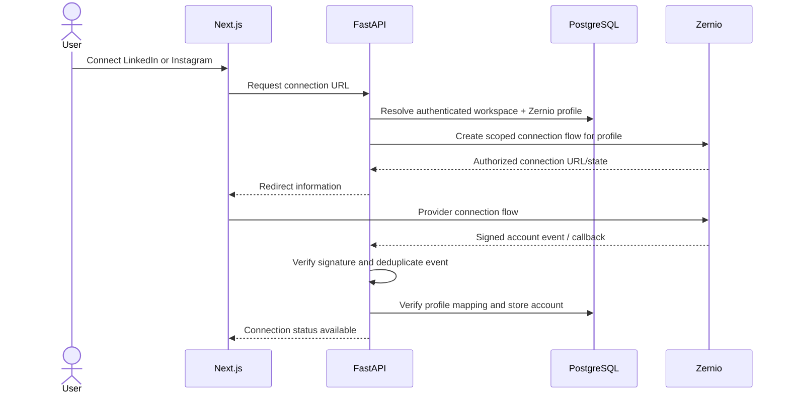

Actual redirects, callback ownership, account selection, reconnect behavior, and platform permissions must be verified for LinkedIn and Instagram.

### 12.3 Scheduling flow

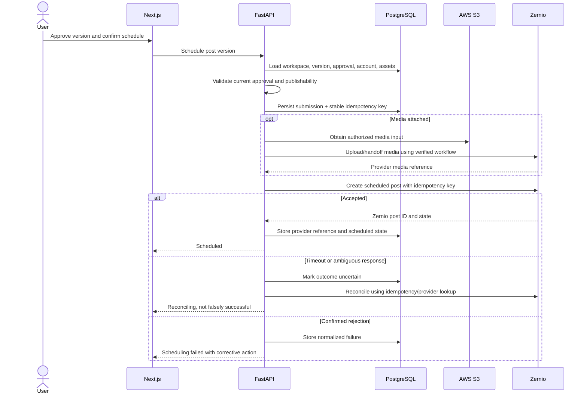

### 12.4 Idempotency

- Generate one random stable idempotency key for each logical publishing submission.
- Persist it before the Zernio request.
- Reuse it for retries of that same submission.
- Never reuse it for a different version, destination, or reschedule.
- Treat the documented 24-hour provider window as an integration constraint.
- After the window or an ambiguous state, reconcile before deciding whether a new submission is safe.

### 12.5 Webhook ingestion

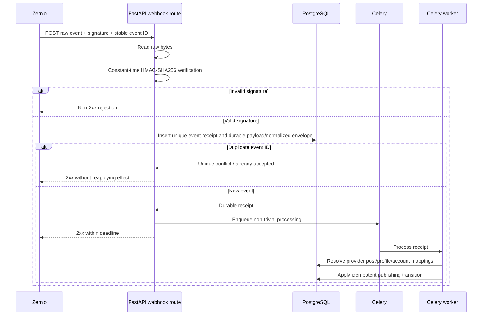

Webhook rules:

- Verify against the exact raw request body before JSON parsing.
- Use `X-Zernio-Event-Id`/payload ID only for event deduplication.
- Do not treat event ID as a post, account, or workspace ID.
- Validate `profiles[].externalId`, profile IDs, account IDs, and provider post IDs against stored mappings.
- Handle at-least-once and out-of-order delivery.
- A later event may refine platform-level partial results; transitions must reject invalid regressions.
- Acknowledgement means durable receipt, not necessarily completed business processing.

### 12.6 Publishing state synchronization

Application states should include:

- `submission_pending`;
- `scheduled`;
- `unschedule_requested`;
- `unscheduled`;
- `publishing`;
- `partially_published` where platforms differ;
- `published`;
- `failed`;
- `outcome_uncertain`;
- `cancelled`.

Provider states are translated through the Zernio adapter. User-facing state comes from PostgreSQL after reconciliation, not directly from an unverified browser callback.

---

## 13. HTTP interface groups

Exact request and response schemas will be specified separately. The architecture exposes versioned HTTP interface groups similar to the following.

| Interface group | Representative operations | Authorization |
|---|---|---|
| Session/workspace | Read current application identity/workspace | Authenticated active account |
| Brand | Read/update one brand profile | Workspace owner |
| Campaigns | Create/list/read; start/retry generation | Workspace owner |
| Jobs | Read status; request cancellation where allowed | Workspace owner and job ownership |
| Posts/versions | Read; manually edit; request AI revision | Workspace owner and post ownership |
| Approvals | Approve current version | Workspace owner; explicit action |
| Media | Create upload intent; confirm upload; request AI image; confirm rights | Workspace owner; campaign/asset relationship |
| Social connections | Initiate connection; list/read/disconnect | Workspace owner |
| Publishing | Schedule; unschedule; manually retry failed submission | Workspace owner; exact version/account eligibility |
| Exports | Request/read/download basic export | Active workspace owner before deletion |
| Account lifecycle | Initiate deletion; controlled restoration path | Authenticated owner or controlled recovery process |
| Zernio webhook | Ingest provider event | Valid HMAC signature, not user JWT |
| Health | Liveness/readiness | Public/internal according to route; no sensitive details |

### 13.1 Interface conventions

- Use a consistent `/api/v1` prefix or equivalent.
- Return opaque application identifiers.
- Validate request and response structures with Pydantic.
- Use `202 Accepted` plus persistent job identity for long-running work.
- Use idempotency identities for duplicate-prone mutations where required.
- Use a consistent safe error envelope with machine code, user-safe message, correlation ID, and optional field details.
- Do not return raw provider errors, stack traces, tokens, S3 keys, or another tenant's existence.
- Pagination and filtering remain workspace-scoped.
- The webhook route has separate authentication, body, timeout, and rate behavior from user routes.

---

## 14. Next.js frontend architecture

Next.js App Router and TypeScript define the web application. Tailwind CSS provides the styling system, while shadcn/ui supplies accessible, composable UI primitives. Neither Tailwind nor shadcn/ui owns product state or authorization rules.

### 14.1 App Router areas

Recommended route composition:

```text
app/
├── (public)/
│   └── page                         landing page
├── (auth)/
│   ├── login/
│   ├── signup/
│   ├── verify-email/
│   └── reset-password/
└── (workspace)/
    ├── dashboard/
    ├── brand/
    ├── campaigns/
    │   ├── new/
    │   └── [campaignId]/
    ├── calendar/
    ├── connections/
    └── settings/
        ├── export/
        └── account/
```

This is a proposed route shape, not a finalized visual information architecture.

### 14.2 Frontend responsibilities

- Present authentication and onboarding.
- Gather campaign inputs.
- Poll persistent jobs and show progress/failures.
- Render strategy and independent post versions.
- Make approval an explicit action with version awareness.
- Prevent editing controls while a post remains scheduled.
- Guide the unschedule/edit/reapprove/reschedule sequence.
- Show connected destination and timezone before scheduling.
- Distinguish failed publication from webhook delivery problems.
- Present image source, license evidence, and confirmation requirement.
- Offer export before destructive account-deletion confirmation.

### 14.3 Frontend non-authority

Client-side controls improve usability but do not enforce:

- workspace ownership;
- image budget;
- approval validity;
- scheduling eligibility;
- connection ownership;
- webhook authenticity;
- deletion/purge eligibility.

FastAPI revalidates every mutation.

### 14.4 Rendering, data fetching, and caching

- Use Server Components for route layouts and initial reads where they can safely forward authenticated context without exposing secrets.
- Use Client Components for forms, polling, editors, approval confirmations, upload progress, and other interactive state.
- Route all product data through the typed FastAPI HTTP client; the frontend does not query Neon PostgreSQL directly.
- Treat authenticated workspace responses as dynamic private data. Do not place them in a cache shared across users.
- Use `no-store` or equivalently private request behavior for security-sensitive/current lifecycle state such as jobs, approvals, connections, publishing, exports, and deletion.
- Revalidate or refetch the affected resource after mutations rather than assuming optimistic state is authoritative.
- Poll persistent jobs using bounded backoff and stop on terminal state, route change, or account inactivity.
- Cache only clearly public/static content unless a workspace-safe cache key and invalidation strategy are explicitly designed.
- No additional client data-fetching/state library is selected by this architecture.

### 14.5 Forms and validation

- TypeScript request/response types follow the versioned FastAPI contract.
- Client validation provides immediate field feedback but never replaces Pydantic and domain validation.
- Forms preserve user input after correctable errors.
- Destructive or externally visible actions—approval, scheduling, unscheduling, manual retry, rights confirmation, and deletion—require explicit confirmation appropriate to their risk.
- A form submits resource/version identifiers that FastAPI revalidates; hidden fields are not trusted.
- Campaign and post forms enforce bounded lengths and supported platform options consistent with backend schemas.

### 14.6 Loading, error, and background states

- Every asynchronous view defines initial loading, empty, partial, failed, cancelled, and retryable states.
- Job progress shows safe stages from PostgreSQL rather than invented percentages.
- Provider failure messages explain the corrective action without exposing raw provider payloads.
- `outcome_uncertain` and `unschedule_requested` are distinct visible states; neither is presented as success.
- A stale-version `409` causes a refetch and asks the user to review the current version rather than overwriting it.
- Authentication expiry returns the user to the documented reauthentication flow while preserving non-sensitive draft form state where practical.

---

## 15. Data export, deletion, and retention

### 15.1 V1 policy

- Export is available before account deletion.
- Initiating deletion immediately disables application access.
- Neon Auth sessions are revoked through the supported provider mechanism.
- Connected-account credentials/connections are revoked or disconnected.
- Pending background jobs are cancelled cooperatively.
- Scheduled but unpublished Zernio posts are cancelled.
- Application data remains recoverable in a soft-deleted state for 30 days.
- Primary application records and owned S3 media are permanently deleted after 30 days.
- Backup expiry target is within 35 days, subject to Neon and AWS capability verification.
- Published social posts remain on LinkedIn/Instagram.
- Legally required retention exceptions are documented and restricted.
- V1 does not build a generalized retention-rule engine.

### 15.2 Export contents

The basic downloadable export should be a packaged archive containing:

- structured workspace and brand data;
- campaigns and strategy summaries;
- post versions, approvals, and scheduling/publishing history;
- retained research source references;
- social connection metadata without tokens or secrets;
- owned uploaded and generated media;
- source/license metadata for relevant assets;
- a manifest describing export version and files.

Provider secrets, password/authentication secrets, internal security logs, signed URLs, and other users' data are excluded.

Export is generated as a persistent job and stored privately with a short-lived download authorization. Export retention duration is an implementation setting and should be short.

### 15.3 Deletion flow

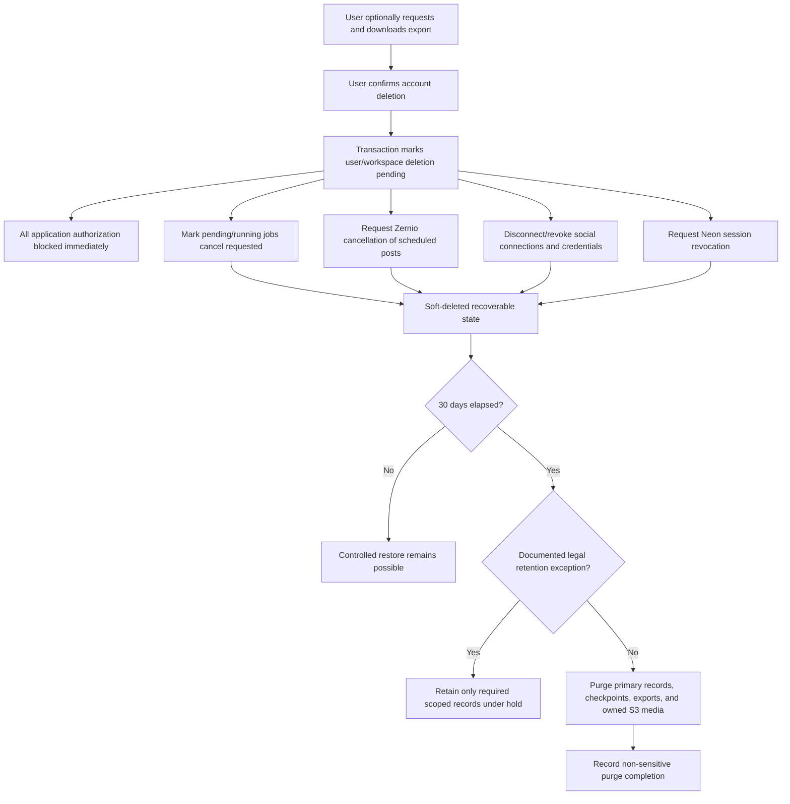

### 15.4 Deletion orchestration

Account access is revoked transactionally and immediately. External cleanup is a retryable background workflow:

1. mark account/workspace inactive and create deletion record;
2. block all normal authorization;
3. request cooperative cancellation for application jobs;
4. enumerate non-terminal Zernio schedules and cancel them;
5. disconnect connected social accounts and remove stored credential references;
6. request Neon session revocation;
7. retain recoverable application state until `purge_after`;
8. after 30 days, idempotently delete owned S3 objects and application records;
9. allow backups to age out by the verified retention policy;
10. record minimal purge completion/audit evidence without retaining deleted content.

External cleanup failure does not restore user access. It remains visible to operators and retries safely.

### 15.5 Restoration

“Recoverable” means a controlled restoration can be performed within 30 days. V1 does not require a self-service retention console. Restoration must:

- verify the requester's identity through a controlled process;
- stop purge eligibility;
- restore application status;
- require fresh authentication;
- require reconnection of social accounts when credentials were revoked;
- not automatically recreate cancelled Zernio schedules;
- not assume cancelled jobs should resume.

### 15.6 Legal exceptions

If law, security investigation, dispute handling, or another documented obligation requires retention:

- retain only the minimum required records;
- record reason, scope, authority, and expiry/review date;
- restrict access;
- exclude retained records from normal product use;
- purge them when the exception expires.

Legal-hold behavior is an operational exception, not a general V1 rules engine.

---

## 16. Security architecture

### 16.1 Control matrix

| Threat | Control |
|---|---|
| Stolen/forged identity token | JWT signature, issuer, audience, expiry, algorithm validation through JWKS |
| Valid old token after deletion | Application user/workspace active-status check on every protected operation |
| Direct-object-reference attack | Workspace-scoped queries and non-disclosing errors |
| Cross-tenant Celery job | Reload job, workspace, and target relationship before execution |
| Cross-tenant agent/tool access | Server-injected workspace context and module interfaces |
| Cross-tenant S3 access | Private bucket, asset ownership lookup, short-lived authorized URLs |
| Zernio account substitution | Stored workspace-profile-account relationship validation |
| Forged webhook | HMAC-SHA256 raw-body verification |
| Replayed/duplicated webhook | Stable event ID unique constraint and idempotent processing |
| Stale content publication | Approval tied to immutable version and rechecked before submission |
| Duplicate public post | Stored idempotency key, reconciliation, manual failed retry |
| Third AI image | Atomic reservation with maximum two active/started slots |
| Prompt injection | Untrusted content handling, allowlisted tools, validated schemas, no privileged tools |
| Secret leakage | AWS-managed secrets, redacted logs, no secrets in browser or graph state |
| Unsafe web image | License/source evidence and explicit human confirmation |

### 16.2 Secrets

Recommended implementation uses AWS Secrets Manager for:

- database credentials/connection configuration where appropriate;
- Neon Auth verification configuration not safe for public exposure;
- AI Credits key;
- Tavily key;
- Zernio API key and webhook secret;
- AWS application credentials only where an EC2 role cannot replace them.

Prefer an EC2 IAM role for S3 and Secrets Manager access rather than static AWS keys. Containers receive required secrets at runtime, not during image build. GitHub Actions uses protected deployment credentials or role-based federation if adopted during implementation.

### 16.3 Logging and privacy

Never log:

- JWTs, cookies, passwords, reset tokens, or OAuth secrets;
- Zernio API credentials or webhook secrets;
- AWS credentials;
- presigned URLs;
- full private prompts/content by default;
- another tenant's identifiers in user-facing errors.

Structured logs may contain safe correlation, workspace, job, campaign, submission, and webhook event IDs with access controls and retention limits.

### 16.4 Required security tests

- known resource ID from another workspace;
- nested-resource and list/count leakage;
- tampered Celery job identifiers;
- mismatched graph thread/campaign/workspace;
- S3 asset-key substitution;
- Zernio profile/account substitution;
- invalid signature, modified body, duplicate webhook, and cross-environment webhook;
- stale approval after edit;
- schedule attempt while unschedule is unresolved;
- concurrent image reservations;
- deleted account using an unexpired JWT;
- prompt injection attempting to call publishing or reveal secrets.

---

## 17. Failure handling and recovery

### 17.1 Failure matrix

| Failure | State and recovery |
|---|---|
| JWT key unavailable | Fail protected request closed; bounded JWKS refresh/cache behavior |
| Workspace provisioning race | Unique constraint resolves to existing workspace |
| DB commit succeeds, Celery publish fails | Dispatch marker recovered and safely redispatched |
| Worker dies mid-graph | Job lease becomes stale; resume from PostgreSQL checkpoint after reconciliation |
| AI output invalid | Bounded repair; then partial/failed job with preserved work |
| Tavily unavailable | Retry transiently; omit/qualify unsupported claim rather than fabricate |
| Image provider rejects before start | Release reservation; no budget consumption |
| Image provider outcome ambiguous | Keep reservation; reconcile before retry/release |
| Image fails after provider start | Slot remains consumed; visible failure |
| S3 validation fails | Asset remains non-publishable; safe replacement path |
| Zernio create times out | Keep uncertain state; reuse idempotency key and reconcile |
| Zernio cancellation fails | Keep original scheduled version locked; show corrective state |
| Zernio publication fails | Show failure; wait for explicit manual retry |
| Duplicate/out-of-order webhook | Deduplicate and apply only valid state transition |
| Redis loss | Rebuild actionable job dispatch from PostgreSQL; no product state loss |
| EC2 restart | Restart containers; reconcile stale jobs and uncertain submissions |
| Account deletion cleanup fails | Access remains blocked; cleanup job retries and alerts operator |

### 17.2 Recovery objectives

Recommended V1 targets, subject to backup-provider verification and a restore drill:

| Objective | Recommended target |
|---|---|
| Application recovery time objective (RTO) | 8 hours |
| Primary database recovery point objective (RPO) | 24 hours maximum, with better managed-provider capability used when available |
| Owned media RPO | 24 hours maximum |
| Backup expiry after account deletion | Within 35 days target |
| Critical publishing/security incident detection | Same operational day; alert thresholds to be implemented |

These are V1 operational targets, not high-availability guarantees. Actual Neon restore granularity, S3 versioning/backup, EC2 configuration recovery, and retention expiry must be documented after verification.

### 17.3 Backup and restore

- Verify Neon backup/restore and retention capabilities for application PostgreSQL and LangGraph checkpoints.
- Enable appropriate S3 protection/versioning only if its retention behavior can meet deletion obligations.
- Keep deployment configuration, Compose definitions, Nginx configuration, and migration history in Git.
- Back up required EC2-host configuration or make the host reproducible from repository plus secrets.
- Do not rely on EC2 local disk for owned media or primary database state.
- Perform a restore drill before production acceptance.
- Document how restored data is reconciled with Zernio events and deletion requests that occurred after the restore point.

---

## 18. AWS deployment architecture

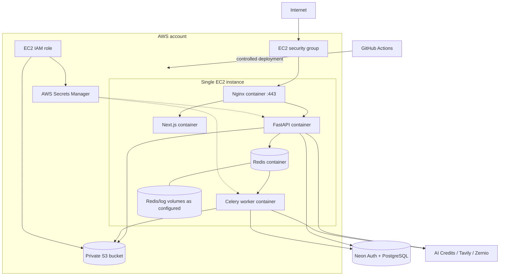

### 18.1 Network exposure

- Public: Nginx ports 80/443, with HTTP redirected to HTTPS.
- Private to Docker network: Next.js internal port, FastAPI internal port, Redis, Celery worker.
- Administrative SSH or management access: restricted by security group and operational policy; exact mechanism pending.
- PostgreSQL, S3, Neon Auth, and providers are reached over TLS.
- Redis is never exposed publicly.

### 18.2 Nginx

- TLS termination and HTTPS redirect.
- Explicit frontend, FastAPI, and Zernio webhook routing.
- Correct forwarding headers.
- Route-appropriate body-size and timeout limits.
- Preserve webhook request bytes; do not transform signed payloads.
- Security headers and controlled error pages.
- No sensitive internal diagnostics exposed publicly.

### 18.3 Docker Compose services

| Container | Responsibility | Durable state |
|---|---|---|
| nginx | Public ingress and TLS routing | Configuration/certificate state per deployment design |
| frontend | Next.js public and authenticated UI | None on container filesystem |
| backend | FastAPI HTTP and webhook ingress | PostgreSQL/S3, not local filesystem |
| celery-worker | AI, media, webhook, export, cleanup jobs | PostgreSQL/S3; checkpoints in PostgreSQL |
| redis | Celery broker and result backend | Persistence configured for V1 recovery, but non-authoritative |

Health checks and restart policies are required. Deployments must allow workers to stop accepting work and finish or safely abandon tasks before termination.

### 18.4 Single-host limitation

This topology is not highly available. Host failure affects web, backend, worker, and Redis. The architecture accepts this for V1 in exchange for cost and operational simplicity. Scaling to separate hosts, managed Redis, load balancing, or ECS requires evidence from availability or capacity measurements.

---

## 19. CI/CD architecture

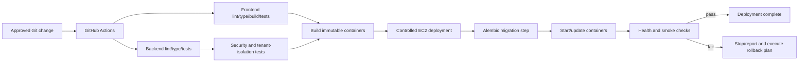

Requirements:

- locked dependencies;
- pinned GitHub Action versions;
- protected production environment;
- immutable build artifacts;
- one controlled migration process;
- secret redaction;
- worker draining/recovery;
- post-deployment health checks;
- a rollback/roll-forward procedure compatible with schema changes;
- deployment failure reporting.

The container registry/transfer mechanism and exact frontend/backend quality tools remain implementation choices.

---

## 20. Observability

No monitoring vendor is finalized. Structured logs and metrics must support diagnosis without exposing secrets or unnecessary private content.

### 20.1 Correlation identifiers

- request/correlation ID;
- authenticated application user and workspace ID where safe;
- campaign, post, and version ID;
- persistent job and AI run/thread ID;
- image-generation event ID;
- publishing submission/attempt and provider post ID;
- webhook event ID;
- account-deletion/export job ID.

### 20.2 Minimum signals

- HTTP latency/errors by safe route pattern;
- authentication failures and JWKS refresh errors;
- authorization denials;
- database pool usage, slow queries, and transaction failures;
- job queue depth, oldest pending job, runtime, retry, cancellation, and failures;
- LangGraph node latency/failures and checkpoint resume count;
- AI Credits/Tavily calls, errors, rate limits, and bounded usage;
- image reservations, starts, completions, pre-start releases, and budget blocks;
- S3 upload/validation/access failures;
- Zernio submission, cancellation, idempotency, reconciliation, and terminal outcomes;
- webhook signature failures, duplicate rate, processing lag, and dead-letter conditions;
- deletion cleanup progress, purge eligibility, and cleanup failures;
- EC2 CPU, memory, disk, container restarts, Redis health, and worker heartbeat.

### 20.3 Audit facts

The system must be able to reconstruct:

- which workspace owned a resource or provider mapping;
- which publishable version a user approved and when;
- which version and destination were submitted to Zernio;
- which idempotency key represented the logical submission;
- why an image slot was reserved, consumed, or released;
- whether a webhook was verified, duplicated, and applied;
- who initiated a manual retry, unschedule, export, deletion, or restoration;
- when primary data and media were purged.

---

## 21. Testing architecture

### 21.1 Test layers

| Layer | Purpose |
|---|---|
| Module behavior | Exercise deep module interfaces and invariants |
| Database integration | Real PostgreSQL transactions, constraints, concurrency, and Alembic migrations |
| Adapter contract | Neon Auth, AI Credits, Tavily, S3, and Zernio assumptions |
| Worker integration | Celery/Redis dispatch, redelivery, cancellation, and recovery |
| Security | Cross-workspace access and forged/substituted inputs |
| End to end | Browser authentication through real supported publishing flow |
| Recovery | Crash, timeout, duplicate, restore, and account-deletion scenarios |

### 21.2 Interface-focused testing

Tests should assert outcomes through the owning module interface:

- Content and Approval tests assert publishability, not internal helper calls.
- Media tests assert slot consumption and asset eligibility, not counter implementation.
- Social Publishing tests assert one logical submission and valid state transitions, not raw HTTP call count alone.
- Retention tests assert access revocation and eventual purge, not internal job ordering.

Provider adapters use mocks/fakes for broad behavior tests plus a smaller suite of real integration/contract tests.

### 21.3 Critical acceptance scenarios

1. Two real users complete the flow without cross-workspace access.
2. A known identifier cannot bypass workspace authorization.
3. A valid unexpired JWT cannot access an account after deletion starts.
4. Concurrent third image generation cannot reach provider-start state.
5. A provider-rejected pre-start image releases its reservation.
6. Editing creates a new version and invalidates approval.
7. A scheduled post cannot be edited until Zernio confirms unscheduling.
8. Manual retry requires explicit authenticated action.
9. A duplicate Celery task does not repeat paid or publishing side effects.
10. Zernio idempotency/reconciliation prevents duplicate posts.
11. Invalid webhooks are rejected; duplicate valid events apply once.
12. Webhook redelivery does not retry publication.
13. S3 assets cannot be accessed across workspaces.
14. Export excludes secrets and contains owned structured data/media.
15. Account deletion blocks access, cancels jobs/schedules, retains for 30 days, then purges primary data/media.
16. Published LinkedIn/Instagram posts remain unaffected by account deletion.
17. Backup/restore drill meets the verified V1 recovery plan.

---

## 22. Key architecture decisions and rationale

### ADR-001 — Modular monolith

**Decision:** One FastAPI application with internal deep modules and a separate Celery worker process.

**Rationale:** Keeps transactions and tenant enforcement local, reduces operational burden, and provides sufficient separation for V1.

**Trade-off:** Backend and worker release together; independent scaling is limited initially.

### ADR-002 — Application-owned tenancy

**Decision:** Neon Auth authenticates identity; PostgreSQL application records own workspace authorization.

**Rationale:** Authentication provider data is not the product tenancy model. Application ownership must cover campaigns, assets, jobs, agents, and Zernio mappings.

**Trade-off:** Every operation must resolve both external identity and application status.

### ADR-003 — Short-lived JWT with JWKS plus application status

**Decision:** Verify short-lived JWTs using Neon JWKS and check active application status on protected operations.

**Rationale:** Supports stateless cryptographic verification while preserving immediate local revocation for deletion/disablement.

**Trade-off:** JWKS caching/rotation and provider session semantics require careful integration testing.

### ADR-004 — PostgreSQL is durable workflow authority

**Decision:** Domain state, persistent jobs, approvals, budgets, webhooks, publishing submissions, and LangGraph checkpoints live in PostgreSQL.

**Rationale:** Redis/Celery metadata is insufficient for product correctness and recovery.

**Trade-off:** Requires explicit schema, transaction, cleanup, and connection-capacity design.

### ADR-005 — LangGraph explicit workflow

**Decision:** Implement logical agent responsibilities as typed graph nodes with PostgreSQL checkpoints.

**Rationale:** Explicit routing, recovery, and cost controls are safer than unconstrained agent conversations.

**Trade-off:** Workflow and checkpoint schema evolution require discipline.

### ADR-006 — Provider-started image budget

**Decision:** Reserve before calling; permanently consume only when provider start is confirmed.

**Rationale:** Matches the chosen business rule without permitting concurrent oversubscription.

**Trade-off:** Ambiguous provider responses require reconciliation and can temporarily occupy a slot.

### ADR-007 — Immutable approved content versions

**Decision:** Approval binds to an immutable publishable-content version.

**Rationale:** Makes the human-control guarantee auditable and prevents stale approval.

**Trade-off:** Edits create additional versions and require reapproval.

### ADR-008 — Unschedule before edit

**Decision:** Scheduled content is locked until Zernio confirms cancellation.

**Rationale:** Prevents divergence between application content and provider-held scheduled content.

**Trade-off:** Editing is slower and depends on provider cancellation behavior.

### ADR-009 — Manual failed-publication retry

**Decision:** Only explicit user action retries a confirmed failed publication.

**Rationale:** Avoids unintended repeated public posts and keeps users in control.

**Trade-off:** Failures require user attention.

### ADR-010 — Zernio-managed scheduling

**Decision:** Zernio executes scheduled LinkedIn/Instagram publishing.

**Rationale:** Avoids building a social scheduling engine and uses documented provider capabilities.

**Trade-off:** Scheduled execution and some recovery behavior sit outside our transaction control.

### ADR-011 — Private S3 with Zernio media handoff

**Decision:** Store owned assets privately in S3 and hand them to Zernio through the verified media workflow.

**Rationale:** Protects tenant media and avoids permanent public objects.

**Trade-off:** URL lifetime/upload compatibility must be tested per platform.

### ADR-012 — Simple 30-day deletion lifecycle

**Decision:** Immediate access revocation, 30-day recoverable soft deletion, then primary-data/media purge; target backup expiry within 35 days.

**Rationale:** Provides recoverability and a clear deletion promise without a generalized retention engine.

**Trade-off:** External cleanup and provider backup expiry require verification and operational tracking.

### ADR-013 — Single EC2 V1

**Decision:** Run Nginx, Next.js, FastAPI, Celery, and Redis through Docker Compose on one EC2 host.

**Rationale:** Appropriate cost and complexity for V1 and an internship implementation.

**Trade-off:** No high availability and shared resource/failure domain.

---

## 23. Implementation phases

### Phase 1 — Foundations

- repository scaffolding;
- runtime/dependency pinning;
- FastAPI composition root and module layout;
- SQLAlchemy/Alembic foundation;
- configuration and AWS secret loading;
- structured errors/logging/health;
- local Docker Compose.

### Phase 2 — Identity and tenancy

- Neon Auth JWT/JWKS integration spike;
- application user/workspace schema;
- idempotent provisioning;
- active-status authorization context;
- negative tenant-isolation tests.

### Phase 3 — Core domain and media

- brand/campaign/post/version/approval schema;
- private S3 adapter and upload flow;
- asset provenance/rights states;
- image slot reservation and concurrency tests.

### Phase 4 — Jobs and AI

- persistent job/dispatch recovery;
- Redis/Celery configuration;
- LangGraph PostgreSQL checkpoint integration;
- AI Credits and Tavily adapters;
- structured campaign/revision workflows.

### Phase 5 — Zernio

- workspace profile provisioning;
- LinkedIn/Instagram connection flows;
- media handoff;
- immutable schedule submission and idempotency;
- signed webhook receipt and deduplication;
- unschedule and manual retry workflows.

### Phase 6 — Frontend completion

- authenticated workspace routes;
- brand and campaign UX;
- job progress;
- post review/version/approval;
- media and rights confirmation;
- calendar, unschedule/edit/reschedule, and failure recovery;
- export and account deletion UX.

### Phase 7 — Operations and verification

- EC2/Nginx/TLS deployment;
- GitHub Actions;
- backups and restore drill;
- deletion/purge verification;
- security and failure tests;
- two-user live end-to-end acceptance.

Do not defer tenant isolation, approval versioning, image-budget concurrency, or idempotency until the end; they shape the core data model.

---

## 24. Architecture readiness checklist

Before implementation begins:

- [ ] Neon JWT/JWKS claims and FastAPI verification contract are documented from a spike.
- [ ] Initial runtime versions are pinned.
- [ ] Database schema and migration ownership are reviewed.
- [ ] Workspace-scoped repository/query conventions are agreed.
- [ ] Post version canonical representation and material fields are fixed.
- [ ] Image provider-start evidence and ambiguous-state behavior are verified.
- [ ] LangGraph PostgreSQL checkpointer lifecycle is proven.
- [ ] Zernio LinkedIn/Instagram profile, connection, media, scheduling, cancellation, retry, and webhook contracts are tested.
- [ ] S3-to-Zernio media flow is proven with private assets.
- [ ] Job dispatch recovery and worker cancellation design are tested.
- [ ] Export format and deletion restoration runbook are approved.
- [ ] Neon/AWS backup retention can meet or transparently qualify the 35-day expiry target.
- [ ] EC2 sizing, connection budgets, secrets, TLS, backup, rollback, RTO, and RPO are recorded.

Before V1 is declared complete:

- [ ] Two real users complete isolated end-to-end flows.
- [ ] Cross-tenant HTTP, task, graph, media, provider, and webhook tests pass.
- [ ] Scheduled edit requires confirmed unscheduling and new approval.
- [ ] Failed publication retries only after explicit user action.
- [ ] Third provider-started AI generation is impossible under concurrency.
- [ ] Duplicate jobs, provider submissions, and webhooks are safe.
- [ ] Failed and uncertain outcomes are truthful.
- [ ] Account deletion immediately blocks access and starts cleanup.
- [ ] Thirty-day purge and backup-expiry behavior are verified to the extent supported.
- [ ] Restore and deployment recovery exercises meet recorded targets.

---

## 25. Implementation-ready application schema catalog

### 25.1 Database namespaces and ownership

Use separate PostgreSQL namespaces where supported and operationally practical:

| Namespace | Ownership |
|---|---|
| Neon Auth-managed namespace | Managed by Neon Auth; application code reads only through documented identity/session integration |
| `app` | Application-owned SQLAlchemy/Alembic tables below |
| LangGraph checkpointer namespace | Managed through a controlled LangGraph checkpointer setup/migration path |

Application Alembic migrations must not modify Neon Auth-managed tables. LangGraph checkpoint rows are application-private workflow data and follow workspace retention, but their physical schema is owned by the supported checkpointer rather than duplicated in application models.

Unless stated otherwise:

- primary keys are `uuid` generated server-side;
- timestamps are timezone-aware `timestamptz` stored in UTC;
- mutable tables include `created_at` and `updated_at`;
- workspace-owned tables include `workspace_id uuid NOT NULL`;
- enum-like values use reviewed PostgreSQL enums or constrained strings consistently; implementation must choose one convention;
- foreign keys default to restrictive deletion until the explicit purge workflow runs;
- sensitive provider payloads are minimized and never contain credentials.

### 25.2 Identity, tenancy, and brand tables

#### `app.application_users`

Purpose: stable application identity mapped to Neon Auth without using email as authorization identity.

| Column | Type | Constraints and meaning |
|---|---|---|
| `id` | `uuid` | Primary key |
| `auth_subject` | `text` | Not null, unique; stable Neon Auth subject |
| `status` | constrained text | `active`, `deletion_pending`, `soft_deleted`, `purged`; not null |
| `display_email` | `text` | Nullable convenience copy; never authorization key |
| `last_authenticated_at` | `timestamptz` | Nullable operational timestamp |
| `deleted_at` | `timestamptz` | Set when deletion begins |
| `purge_after` | `timestamptz` | Normally `deleted_at + 30 days` |
| `created_at` | `timestamptz` | Not null |
| `updated_at` | `timestamptz` | Not null |

Indexes/constraints:

- unique index on `auth_subject`;
- index on `(status, purge_after)` for purge eligibility;
- check requiring `deleted_at` and `purge_after` for deletion states.

#### `app.workspaces`

Purpose: canonical tenant and authorization scope.

| Column | Type | Constraints and meaning |
|---|---|---|
| `id` | `uuid` | Primary key |
| `owner_user_id` | `uuid` | Foreign key to `application_users`, not null, unique in V1 |
| `status` | constrained text | `active`, `deletion_pending`, `soft_deleted`, `purged` |
| `timezone` | `text` | IANA timezone identifier; required before scheduling |
| `created_at` | `timestamptz` | Not null |
| `updated_at` | `timestamptz` | Not null |

Indexes/constraints:

- unique index on `owner_user_id` enforces one V1 workspace per user;
- check that workspace status is compatible with owner status;
- primary lookup is by owner and active status during authentication.

#### `app.brand_profiles`

Purpose: one reusable brand profile per workspace.

| Column | Type | Constraints and meaning |
|---|---|---|
| `id` | `uuid` | Primary key |
| `workspace_id` | `uuid` | Foreign key to workspace, not null, unique |
| `name` | `text` | Brand/product name; validated length |
| `description` | `text` | Brand/product description |
| `website_url` | `text` | Nullable validated HTTPS/HTTP URL |
| `target_audience` | `text` | Nullable |
| `voice_tone` | `text` | Nullable |
| `logo_asset_id` | `uuid` | Nullable foreign key to same-workspace asset |
| `created_at` | `timestamptz` | Not null |
| `updated_at` | `timestamptz` | Not null |

Indexes/constraints:

- unique index on `workspace_id`;
- same-workspace validation for `logo_asset_id`;
- logo must be a validated publishable or private-display asset of an allowed image type.

### 25.3 Campaign, research, and AI tables

#### `app.campaigns`

Purpose: durable campaign request, resolved context, lifecycle, and image-slot authority.

| Column | Type | Constraints and meaning |
|---|---|---|
| `id` | `uuid` | Primary key |
| `workspace_id` | `uuid` | Workspace foreign key, not null |
| `status` | constrained text | `draft`, `generation_pending`, `generating`, `partial_ready`, `in_review`, `completed`, `generation_failed`, `soft_deleted` |
| `prompt` | `text` | User's natural-language request; required when structured input is insufficient |
| `structured_input` | `jsonb` | Validated campaign fields and selected platforms |
| `resolved_brand_context` | `jsonb` | Immutable generation-time snapshot of saved profile plus overrides |
| `strategy_summary` | `text` | Nullable until generated |
| `image_slots_reserved` | `smallint` | Not null, default 0 |
| `image_generations_started` | `smallint` | Not null, default 0 |
| `created_by_user_id` | `uuid` | Foreign key to workspace owner |
| `created_at` | `timestamptz` | Not null |
| `updated_at` | `timestamptz` | Not null |

Constraints/indexes:

- check `image_slots_reserved >= 0`;
- check `image_generations_started BETWEEN 0 AND 2`;
- check `image_slots_reserved + image_generations_started <= 2`;
- selected platforms limited to `linkedin` and/or `instagram` in V1 validation;
- indexes on `(workspace_id, created_at DESC)` and `(workspace_id, status)`.

#### `app.research_sources`

Purpose: retain external sources used to support campaign facts.

| Column | Type | Constraints and meaning |
|---|---|---|
| `id` | `uuid` | Primary key |
| `workspace_id` | `uuid` | Workspace foreign key |
| `campaign_id` | `uuid` | Campaign foreign key |
| `url` | `text` | Validated source URL |
| `title` | `text` | Nullable normalized title |
| `publisher` | `text` | Nullable |
| `published_at` | `timestamptz` | Nullable source publication time |
| `retrieved_at` | `timestamptz` | Not null |
| `excerpt` | `text` | Bounded excerpt/summary, not an unrestricted page copy |
| `source_quality` | constrained text | Application assessment such as `preferred`, `acceptable`, `weak`, `rejected` |
| `provider_metadata` | `jsonb` | Minimal non-secret Tavily metadata |

Constraints/indexes:

- same-workspace campaign relationship;
- uniqueness recommendation on `(campaign_id, url)`;
- index on `(workspace_id, campaign_id)`;
- rejected sources cannot be attached as supporting evidence.

#### `app.ai_runs`

Purpose: durable record of each campaign generation or targeted revision run.

| Column | Type | Constraints and meaning |
|---|---|---|
| `id` | `uuid` | Primary key |
| `workspace_id` | `uuid` | Workspace foreign key |
| `campaign_id` | `uuid` | Campaign foreign key |
| `post_id` | `uuid` | Nullable for campaign-wide run; set for targeted revision |
| `background_job_id` | `uuid` | Unique foreign key to job |
| `run_type` | constrained text | `campaign_generation`, `post_revision` |
| `langgraph_thread_id` | `text` | Not null, unique within environment |
| `status` | constrained text | `pending`, `running`, `succeeded`, `partial`, `failed`, `cancelled` |
| `research_used` | `boolean` | Not null, default false |
| `usage_summary` | `jsonb` | Bounded model/search/image usage metadata |
| `safe_error_code` | `text` | Nullable |
| `started_at` | `timestamptz` | Nullable |
| `finished_at` | `timestamptz` | Nullable |

Indexes:

- `(workspace_id, campaign_id, created_at DESC)`;
- unique `langgraph_thread_id`;
- `(status, started_at)` for recovery diagnostics.

#### `app.image_generation_events`

Purpose: concurrency-safe reservations and permanent accounting for provider-started generations.

| Column | Type | Constraints and meaning |
|---|---|---|
| `id` | `uuid` | Primary key |
| `workspace_id` | `uuid` | Workspace foreign key |
| `campaign_id` | `uuid` | Campaign foreign key |
| `post_id` | `uuid` | Nullable target post |
| `logical_request_key` | `text` | Not null, unique per logical request |
| `status` | constrained text | `reserved`, `started`, `completed`, `failed_before_start`, `failed_after_start`, `outcome_uncertain` |
| `provider_request_id` | `text` | Nullable provider reference |
| `provider_started_at` | `timestamptz` | Set only with provider-start evidence |
| `asset_id` | `uuid` | Nullable resulting asset |
| `safe_error_code` | `text` | Nullable |
| `reserved_at` | `timestamptz` | Not null |
| `resolved_at` | `timestamptz` | Nullable |

Constraints/indexes:

- unique `(campaign_id, logical_request_key)` or globally unique logical key;
- same-workspace campaign/post/asset relationships;
- provider-start timestamp required for started/completed/failed-after-start;
- indexes on `(campaign_id, status)` and `(status, reserved_at)` for reconciliation.

### 25.4 Content and approval tables

#### `app.posts`

Purpose: stable campaign post identity and pointer to current publishable version.

| Column | Type | Constraints and meaning |
|---|---|---|
| `id` | `uuid` | Primary key |
| `workspace_id` | `uuid` | Workspace foreign key |
| `campaign_id` | `uuid` | Campaign foreign key |
| `platform` | constrained text | `linkedin` or `instagram` |
| `current_version_id` | `uuid` | Nullable during creation; same-post foreign key |
| `review_state` | constrained text | `review_required`, `approved` |
| `created_at` | `timestamptz` | Not null |
| `updated_at` | `timestamptz` | Not null |

Constraints/indexes:

- same-workspace campaign;
- current version must belong to the same post;
- indexes on `(campaign_id, platform)`, `(workspace_id, review_state)`, and `(workspace_id, updated_at DESC)`.

#### `app.post_versions`

Purpose: immutable canonical publishable-content snapshots.

| Column | Type | Constraints and meaning |
|---|---|---|
| `id` | `uuid` | Primary key |
| `workspace_id` | `uuid` | Workspace foreign key |
| `post_id` | `uuid` | Post foreign key |
| `version_number` | `integer` | Starts at 1 and increases per post |
| `caption` | `text` | Platform-validated content |
| `hashtags` | `jsonb` | Ordered validated string array |
| `platform_options` | `jsonb` | Allowlisted LinkedIn/Instagram publishable options |
| `content_hash` | `text` | Not null; hash of canonical publishable representation |
| `created_by_type` | constrained text | `ai`, `user`, `system` |
| `created_by_user_id` | `uuid` | Nullable for AI/system; workspace user when manual |
| `revision_instruction` | `text` | Nullable, bounded user instruction for AI revisions |
| `created_at` | `timestamptz` | Not null; versions are not updated |

Constraints/indexes:

- unique `(post_id, version_number)`;
- same-workspace post;
- unique recommendation `(post_id, content_hash)` to avoid accidental duplicate versions, subject to UX needs;
- no ordinary update operation after creation;
- index `(workspace_id, post_id, version_number DESC)`.

#### `app.post_version_assets`

Purpose: ordered association between an immutable post version and media.

| Column | Type | Constraints and meaning |
|---|---|---|
| `post_version_id` | `uuid` | Composite primary key part; foreign key |
| `asset_id` | `uuid` | Composite primary key part; foreign key |
| `workspace_id` | `uuid` | Workspace ownership |
| `position` | `smallint` | Not null, zero-based or one-based convention selected once |
| `alt_text` | `text` | Nullable/required according to platform and accessibility policy |

Constraints/indexes:

- primary key `(post_version_id, asset_id)`;
- unique `(post_version_id, position)`;
- same workspace for version and asset;
- asset must be validated and rights-eligible before scheduling.

#### `app.post_version_sources`

Purpose: attach research evidence to the version whose claims rely on it.

| Column | Type | Constraints and meaning |
|---|---|---|
| `post_version_id` | `uuid` | Composite primary key part |
| `research_source_id` | `uuid` | Composite primary key part |
| `workspace_id` | `uuid` | Workspace ownership |

Constraints: same workspace and campaign; rejected sources cannot be attached.

#### `app.approvals`

Purpose: audit an explicit user decision for one exact immutable version.

| Column | Type | Constraints and meaning |
|---|---|---|
| `id` | `uuid` | Primary key |
| `workspace_id` | `uuid` | Workspace foreign key |
| `post_version_id` | `uuid` | Not null, unique foreign key |
| `approved_by_user_id` | `uuid` | Workspace owner foreign key |
| `content_hash` | `text` | Must match approved version hash |
| `approved_at` | `timestamptz` | Not null |
| `invalidated_at` | `timestamptz` | Nullable historical invalidation timestamp |
| `invalidation_reason` | `text` | Nullable constrained safe reason |

Rules/indexes:

- one approval record per version;
- a version is currently publishable only when it is the post's current version, its approval is not invalidated, and its hash still matches;
- schedule-only changes do not mutate or invalidate this row;
- index `(workspace_id, approved_at DESC)`.

### 25.5 Media tables

#### `app.assets`

Purpose: application-owned media metadata and authorization record.

| Column | Type | Constraints and meaning |
|---|---|---|
| `id` | `uuid` | Primary key |
| `workspace_id` | `uuid` | Workspace foreign key |
| `provenance` | constrained text | `user_upload`, `ai_generated`, `web_discovered` |
| `storage_status` | constrained text | `pending`, `stored`, `deleted`, `external_reference` |
| `object_key` | `text` | Nullable unique S3 key; required for owned stored media |
| `original_filename` | `text` | Nullable sanitized display value |
| `media_type` | `text` | Validated MIME type |
| `byte_size` | `bigint` | Nullable until upload confirmed |
| `width` | `integer` | Nullable |
| `height` | `integer` | Nullable |
| `checksum` | `text` | Nullable/required after owned upload |
| `validation_status` | constrained text | `pending`, `valid`, `rejected` |
| `rights_status` | constrained text | `owned`, `license_verified`, `user_confirmed`, `unclear`, `rejected` |
| `source_url` | `text` | Required for web-discovered media |
| `license_summary` | `text` | Nullable bounded summary |
| `rights_confirmed_by_user_id` | `uuid` | Nullable |
| `rights_confirmed_at` | `timestamptz` | Nullable |
| `created_at` | `timestamptz` | Not null |
| `deleted_at` | `timestamptz` | Nullable |

Constraints/indexes:

- unique `object_key` when non-null;
- source URL required for web-discovered assets;
- rights confirmation identity/time must appear together;
- indexes `(workspace_id, created_at DESC)`, `(workspace_id, validation_status, rights_status)`, and checksum where deduplication is implemented.

#### `app.upload_intents`

Purpose: short-lived authorization for a specific workspace-owned upload.

| Column | Type | Constraints and meaning |
|---|---|---|
| `id` | `uuid` | Primary key |
| `workspace_id` | `uuid` | Workspace foreign key |
| `asset_id` | `uuid` | Unique foreign key |
| `object_key` | `text` | Unique server-generated key |
| `expected_media_type` | `text` | Allowlisted |
| `max_byte_size` | `bigint` | Positive, within configured limit |
| `expires_at` | `timestamptz` | Short-lived |
| `completed_at` | `timestamptz` | Nullable |

Index `(workspace_id, expires_at)` supports cleanup. Presigned URL/signature material is not stored as a reusable secret.

### 25.6 Job and workflow tables

#### `app.background_jobs`

Purpose: durable user-visible task intent and recovery authority.

| Column | Type | Constraints and meaning |
|---|---|---|
| `id` | `uuid` | Primary key |
| `workspace_id` | `uuid` | Workspace foreign key |
| `job_type` | constrained text | Campaign, revision, image, media, webhook, export, cleanup, reconciliation |
| `logical_key` | `text` | Unique idempotency identity |
| `target_type` | constrained text | Safe allowlisted target category |
| `target_id` | `uuid` | Target resource identifier |
| `status` | constrained text | `pending`, `dispatch_pending`, `queued`, `running`, `retry_waiting`, `succeeded`, `failed`, `cancel_requested`, `cancelled` |
| `progress_current` | `integer` | Nullable, non-negative |
| `progress_total` | `integer` | Nullable, positive when set |
| `progress_stage` | `text` | Safe bounded stage label |
| `celery_task_id` | `text` | Nullable diagnostic identity, not product identity |
| `attempt_count` | `integer` | Not null, default 0 |
| `max_attempts` | `integer` | Not null, task-policy value |
| `available_at` | `timestamptz` | Retry/dispatch eligibility |
| `lease_expires_at` | `timestamptz` | Nullable worker-claim lease |
| `heartbeat_at` | `timestamptz` | Nullable |
| `cancel_requested_at` | `timestamptz` | Nullable |
| `safe_error_code` | `text` | Nullable |
| `safe_error_message` | `text` | Nullable bounded user-safe text |
| `created_at` | `timestamptz` | Not null |
| `started_at` | `timestamptz` | Nullable |
| `finished_at` | `timestamptz` | Nullable |

Indexes/constraints:

- unique `logical_key` in the appropriate operation scope;
- indexes `(status, available_at)`, `(status, lease_expires_at)`, `(workspace_id, created_at DESC)`, and `(workspace_id, target_type, target_id)`;
- progress values must be internally consistent;
- terminal states require `finished_at`.

LangGraph checkpoint tables are linked logically through `ai_runs.langgraph_thread_id`; application code does not duplicate checkpoint payloads in `background_jobs`.

### 25.7 Zernio and publishing tables

#### `app.zernio_profiles`

Purpose: one provider customer profile per workspace.

| Column | Type | Constraints and meaning |
|---|---|---|
| `id` | `uuid` | Primary key |
| `workspace_id` | `uuid` | Unique workspace foreign key |
| `provider_profile_id` | `text` | Not null, unique |
| `external_id` | `text` | Not null, unique; opaque workspace mapping |
| `status` | constrained text | `provisioning`, `active`, `attention_required`, `disconnected` |
| `created_at` | `timestamptz` | Not null |
| `updated_at` | `timestamptz` | Not null |

#### `app.social_accounts`

Purpose: workspace-scoped LinkedIn/Instagram destination metadata managed through Zernio.

| Column | Type | Constraints and meaning |
|---|---|---|
| `id` | `uuid` | Primary key |
| `workspace_id` | `uuid` | Workspace foreign key |
| `zernio_profile_id` | `uuid` | Application Zernio-profile foreign key |
| `provider_account_id` | `text` | Not null |
| `platform` | constrained text | `linkedin` or `instagram` |
| `display_name` | `text` | Nullable safe metadata |
| `status` | constrained text | `active`, `attention_required`, `disconnected`, `unknown` |
| `provider_metadata` | `jsonb` | Minimal non-secret identifiers/capabilities |
| `last_verified_at` | `timestamptz` | Nullable |

Constraints/indexes:

- unique `(zernio_profile_id, provider_account_id)`;
- same workspace as Zernio profile;
- indexes `(workspace_id, platform, status)` and provider account ID;
- no social access tokens stored unless Zernio's verified integration explicitly requires it; if required, use encrypted secret storage rather than ordinary metadata.

#### `app.publishing_submissions`

Purpose: one immutable logical handoff of an approved version to one destination and schedule.

| Column | Type | Constraints and meaning |
|---|---|---|
| `id` | `uuid` | Primary key |
| `workspace_id` | `uuid` | Workspace foreign key |
| `post_version_id` | `uuid` | Exact approved version foreign key |
| `approval_id` | `uuid` | Approval foreign key |
| `social_account_id` | `uuid` | Destination foreign key |
| `scheduled_for_utc` | `timestamptz` | Required for scheduled publishing |
| `schedule_timezone` | `text` | IANA timezone shown to user |
| `idempotency_key` | `text` | Not null, unique |
| `provider_post_id` | `text` | Nullable until accepted; unique when present in integration scope |
| `status` | constrained text | `submission_pending`, `scheduled`, `reschedule_pending`, `unschedule_requested`, `unscheduled`, `publishing`, `partially_published`, `published`, `failed`, `outcome_uncertain`, `cancelled` |
| `provider_state` | `text` | Nullable normalized/raw-safe diagnostic state |
| `last_reconciled_at` | `timestamptz` | Nullable |
| `created_by_user_id` | `uuid` | Workspace owner |
| `created_at` | `timestamptz` | Not null |
| `updated_at` | `timestamptz` | Not null |

Constraints/indexes:

- approval must reference the same `post_version_id` and remain valid at submission;
- account, version, and approval must share workspace;
- unique `idempotency_key`;
- unique provider post ID where present;
- indexes `(workspace_id, status, scheduled_for_utc)`, `(post_version_id, created_at DESC)`, and `(social_account_id, status)`;
- content is never copied from a newer version into an existing submission.

#### `app.publishing_attempts`

Purpose: immutable audit of provider calls, including manual retry, cancellation, reschedule, and reconciliation.

| Column | Type | Constraints and meaning |
|---|---|---|
| `id` | `uuid` | Primary key |
| `workspace_id` | `uuid` | Workspace foreign key |
| `publishing_submission_id` | `uuid` | Submission foreign key |
| `attempt_kind` | constrained text | `create`, `reschedule`, `unschedule`, `manual_retry`, `reconcile`, `media_upload` |
| `initiated_by_user_id` | `uuid` | Required for manual retry/user operations; nullable for reconciliation |
| `request_id` | `text` | Safe local/provider request correlation |
| `outcome` | constrained text | `pending`, `accepted`, `rejected`, `timeout`, `uncertain`, `failed` |
| `safe_error_code` | `text` | Nullable |
| `started_at` | `timestamptz` | Not null |
| `finished_at` | `timestamptz` | Nullable |

Index `(publishing_submission_id, started_at DESC)` and `(workspace_id, outcome)`.

#### `app.provider_platform_results`

Purpose: retain LinkedIn/Instagram-specific results for partial or complete publication.

| Column | Type | Constraints and meaning |
|---|---|---|
| `id` | `uuid` | Primary key |
| `workspace_id` | `uuid` | Workspace foreign key |
| `publishing_submission_id` | `uuid` | Submission foreign key |
| `platform` | constrained text | `linkedin` or `instagram` |
| `provider_account_id` | `text` | Destination correlation |
| `status` | constrained text | `scheduled`, `publishing`, `published`, `failed`, `cancelled`, `unknown` |
| `platform_post_id` | `text` | Nullable |
| `platform_post_url` | `text` | Nullable validated URL |
| `safe_error_code` | `text` | Nullable |
| `occurred_at` | `timestamptz` | Provider event time when known |
| `updated_at` | `timestamptz` | Not null |

Unique recommendation `(publishing_submission_id, platform, provider_account_id)`.

#### `app.webhook_receipts`

Purpose: durable authenticated receipt and deduplication of Zernio at-least-once events.

| Column | Type | Constraints and meaning |
|---|---|---|
| `id` | `uuid` | Primary key |
| `provider_event_id` | `text` | Not null, unique stable Zernio event ID |
| `event_type` | `text` | Allowlisted event name |
| `workspace_id` | `uuid` | Nullable until safely resolved; set after mapping |
| `provider_profile_id` | `text` | Nullable routing evidence |
| `provider_post_id` | `text` | Nullable |
| `payload` | `jsonb` | Minimized durable payload/normalized envelope per retention policy |
| `status` | constrained text | `received`, `processing`, `processed`, `ignored`, `failed` |
| `attempt_count` | `integer` | Application-processing attempts, not Zernio delivery attempt |
| `received_at` | `timestamptz` | Not null |
| `processed_at` | `timestamptz` | Nullable |
| `safe_error_code` | `text` | Nullable |

Constraints/indexes:

- unique provider event ID;
- indexes `(status, received_at)`, `(provider_post_id, received_at)`, `(workspace_id, received_at DESC)`;
- signature is verified before insert;
- invalid signatures are not stored as trusted webhook receipts, though a safe security metric/log may be emitted.

### 25.8 Export, deletion, legal exception, and audit tables

#### `app.data_exports`

Purpose: track basic pre-deletion workspace exports.

| Column | Type | Constraints and meaning |
|---|---|---|
| `id` | `uuid` | Primary key |
| `workspace_id` | `uuid` | Workspace foreign key |
| `background_job_id` | `uuid` | Unique job foreign key |
| `status` | constrained text | `pending`, `building`, `ready`, `failed`, `expired`, `deleted` |
| `object_key` | `text` | Nullable unique private S3 archive key |
| `manifest_version` | `text` | Export format version |
| `expires_at` | `timestamptz` | Short-lived download expiry |
| `downloaded_at` | `timestamptz` | Nullable |
| `created_at` | `timestamptz` | Not null |

Indexes `(workspace_id, created_at DESC)` and `(status, expires_at)`.

#### `app.account_deletions`

Purpose: authoritative simple 30-day deletion lifecycle.

| Column | Type | Constraints and meaning |
|---|---|---|
| `id` | `uuid` | Primary key |
| `application_user_id` | `uuid` | User foreign key, unique for active deletion |
| `workspace_id` | `uuid` | Workspace foreign key |
| `status` | constrained text | `initiated`, `cleanup_running`, `soft_deleted`, `restore_requested`, `restored`, `purge_running`, `purged`, `cleanup_attention_required` |
| `initiated_at` | `timestamptz` | Not null |
| `purge_after` | `timestamptz` | Not null, normally 30 days later |
| `restored_at` | `timestamptz` | Nullable |
| `purged_at` | `timestamptz` | Nullable |
| `cleanup_summary` | `jsonb` | Non-secret per-step outcomes |
| `safe_error_code` | `text` | Nullable |

Indexes `(status, purge_after)` and unique partial constraint for one non-terminal deletion per user/workspace.

#### `app.legal_holds`

Purpose: minimal documented exception to normal purge.

| Column | Type | Constraints and meaning |
|---|---|---|
| `id` | `uuid` | Primary key |
| `workspace_id` | `uuid` | Workspace foreign key |
| `reason_code` | `text` | Required controlled reason |
| `scope` | `jsonb` | Minimum data categories/records retained |
| `authority_reference` | `text` | Restricted internal reference |
| `starts_at` | `timestamptz` | Not null |
| `review_or_expires_at` | `timestamptz` | Not null |
| `released_at` | `timestamptz` | Nullable |

This is an operational exception record, not a general retention-rules engine.

#### `app.audit_events`

Purpose: safe immutable audit facts for approval, publishing, security-sensitive lifecycle, export, and deletion.

| Column | Type | Constraints and meaning |
|---|---|---|
| `id` | `uuid` | Primary key |
| `workspace_id` | `uuid` | Nullable only for pre-resolution security events |
| `actor_type` | constrained text | `user`, `system`, `worker`, `provider` |
| `actor_id` | `text` | Safe internal identity/reference |
| `event_type` | `text` | Allowlisted audit event |
| `resource_type` | `text` | Safe category |
| `resource_id` | `uuid` | Nullable |
| `metadata` | `jsonb` | Minimized, non-secret, non-content metadata |
| `occurred_at` | `timestamptz` | Not null |

Indexes `(workspace_id, occurred_at DESC)`, `(event_type, occurred_at)`, and resource lookup. Audit retention must be documented; legal exceptions may apply, but private content should not be copied into audit metadata.

### 25.9 Cross-table invariants

1. All joined workspace-owned records must have matching `workspace_id`.
2. A user cannot own more than one V1 workspace.
3. A post's current version belongs to that post.
4. Only the current version with a valid approval is eligible for a new submission.
5. Schedule-only changes reuse the approval; publishable or destination changes require a new version and approval.
6. A campaign never has more than two reserved-plus-started image slots; only started events count permanently.
7. A social account belongs to the workspace's one Zernio profile.
8. One logical publication uses one idempotency key; manual retry is a recorded user action.
9. A webhook event is accepted once and applied idempotently.
10. Deletion-pending or soft-deleted workspaces cannot create jobs, versions, approvals, assets, or submissions.

---

## 26. FastAPI interface contracts

### 26.1 Versioning, authentication, and common responses

- User-facing HTTP interfaces use `/api/v1`.
- Zernio webhook ingress uses `/webhooks/zernio`; provider versioning is handled inside the adapter.
- Protected interfaces require a valid Neon JWT and active application workspace.
- JSON request bodies reject unknown security-sensitive fields and enforce bounded lengths.
- Times are ISO 8601 with timezone; scheduling requires a future effective time according to the finalized scheduling tolerance.
- Identifiers are opaque UUID strings.

Successful single-resource shape:

```text
{
  "data": { ...resource... },
  "meta": { "request_id": "..." }
}
```

Accepted background-job shape:

```text
{
  "data": {
    "resource_id": "...",
    "job": { "id": "...", "status": "pending" }
  },
  "meta": { "request_id": "..." }
}
```

Error shape:

```text
{
  "error": {
    "code": "stable_machine_code",
    "message": "safe corrective message",
    "field_errors": { "field": ["reason"] },
    "request_id": "..."
  }
}
```

`field_errors` is optional. Provider bodies, stack traces, secrets, and cross-tenant details are never returned.

Common statuses:

| Status | Use |
|---:|---|
| `200` | Successful read/update/action with immediate result |
| `201` | Synchronously created durable resource |
| `202` | Accepted long-running operation |
| `204` | Successful action with no body where useful |
| `400` | Malformed semantic request not covered by field validation |
| `401` | Missing/invalid/expired authentication |
| `404` | Resource not found or not visible in authenticated workspace |
| `409` | Stale version, invalid lifecycle transition, duplicate/conflicting operation |
| `422` | Pydantic field validation failure |
| `429` | Application/provider quota or rate limit, including exhausted image budget |
| `502` | Confirmed upstream failure safely normalized |
| `503` | Required dependency unavailable; retry guidance may be included |

### 26.2 Identity and workspace

#### `GET /api/v1/me`

- Authentication: required.
- Input: no body.
- Output fields: application user ID, workspace ID, account/workspace status, display email if available, timezone, onboarding flags.
- Behavior: verifies JWT then idempotently provisions first workspace if absent.
- Errors: `401` invalid token; `503` identity verification unavailable; deletion states return access-denied behavior rather than active workspace data.

#### `PATCH /api/v1/workspace`

- Authentication/authorization: active workspace owner.
- Request: `{ "timezone": "IANA/Zone" }`.
- Validation: valid IANA timezone.
- Response: updated workspace view.
- Errors: `409` inactive/deleting workspace; `422` invalid timezone.

### 26.3 Brand profile

#### `GET /api/v1/brand-profile`

- Returns the current workspace's profile or an explicit empty/not-configured representation.

#### `PUT /api/v1/brand-profile`

- Authentication/authorization: active workspace owner.
- Request fields: `name`, `description`, optional `website_url`, optional `target_audience`, optional `voice_tone`, optional `logo_asset_id`.
- Validation: bounded text; URL format; logo belongs to workspace and is validated.
- Response: complete persisted profile.
- Errors: `404` invisible logo; `409` invalid asset state; `422` field validation.

### 26.4 Campaigns and jobs

#### `POST /api/v1/campaigns`

- Headers: optional application `Idempotency-Key` recommended for duplicate form submissions.
- Request fields:
  - required `prompt` unless structured fields provide sufficient goal;
  - optional `goal`, `target_audience`, `tone`, `post_count`, `date_range`;
  - `platforms`: non-empty subset of `linkedin`, `instagram`;
  - optional campaign-only brand overrides.
- Behavior: creates campaign, persistent generation job, AI run, and dispatch marker transactionally.
- Response: `202` campaign ID plus job view.
- Validation: bounded prompt; configured post-count limit; coherent date range; supported platforms.
- Errors: `409` duplicate logical request/state; `422` invalid fields; `429` workspace usage limit when later defined.

#### `GET /api/v1/campaigns`

- Query: cursor, bounded page size, optional status.
- Response: workspace-scoped summaries; never includes another workspace's counts.

#### `GET /api/v1/campaigns/{campaign_id}`

- Response: campaign, strategy, research-reference summary, image budget `{reserved, started, remaining}`, post summaries, and generation job status.
- Errors: `404` for missing/invisible campaign.

#### `POST /api/v1/campaigns/{campaign_id}/retry-generation`

- Allowed only after recoverable partial/failed generation and no active equivalent job.
- Creates a new job/run or resumes a checkpoint according to failure classification.
- Response: `202` job view.
- Never resets image started count.

#### `GET /api/v1/jobs/{job_id}`

- Response fields: ID, type, status, safe stage/progress, attempts, timestamps, safe error.
- Authorization: job workspace must match authenticated workspace.

#### `POST /api/v1/jobs/{job_id}/cancel`

- Allowed for cancellable, non-terminal jobs.
- Response: updated job with `cancel_requested` or `cancelled`.
- `409` when operation is no longer cancellable.

### 26.5 Posts, versions, and approvals

#### `GET /api/v1/posts/{post_id}`

- Response: post, current immutable version, version history metadata, approval state, sources/assets, latest publishing state.

#### `POST /api/v1/posts/{post_id}/versions`

- Purpose: manual edit producing a new version.
- Request: complete proposed publishable fields or an edit payload resolved against the current version; implementation must choose one unambiguous convention. Complete replacement is recommended for audit clarity.
- Requires post not currently locked by a scheduled/publishing submission.
- Creates a new immutable version, sets it current, marks review required, and invalidates prior current-version approval.
- Response: `201` new version view.
- Errors: `409` scheduled/unschedule-pending/stale current version; `422` platform content validation.

#### `POST /api/v1/posts/{post_id}/ai-revisions`

- Request: `base_version_id`, bounded `instruction`.
- Validation: base must be current; post must be editable; no equivalent active revision job.
- Response: `202` job view.
- Result: a new immutable version; no automatic approval.

#### `POST /api/v1/posts/{post_id}/approvals`

- Request: `post_version_id`, `content_hash` displayed to the user.
- Transaction verifies version is current, hash matches, assets are reviewable, and account is active.
- Response: `201` approval view.
- Errors: `409` stale version/hash, invalid asset state, or scheduled state conflict.

### 26.6 Media and image generation

#### `POST /api/v1/media/upload-intents`

- Request: filename, declared MIME type, byte size.
- Response: `201` asset ID, upload intent ID, short-lived presigned upload fields/URL, expiry.
- Validation: allowed type/size; server creates object key.

#### `POST /api/v1/media/upload-intents/{intent_id}/complete`

- Request: upload completion/checksum metadata required by chosen S3 flow.
- Behavior: verifies S3 object, marks validation pending, starts media-validation job if needed.
- Response: `202` asset/job or immediate validated asset.

#### `POST /api/v1/campaigns/{campaign_id}/image-generations`

- Request: optional post ID, prompt/visual instruction, logical request key.
- Transaction reserves one slot; response is `202` event/job.
- Errors: `429 image_budget_exhausted`; `409` duplicate/ambiguous existing request.
- A provider pre-start rejection releases the reservation; provider-started failure consumes it.

#### `POST /api/v1/media/{asset_id}/rights-confirmation`

- Only for web-discovered media with sufficient recorded source/license evidence.
- Request: explicit confirmation boolean/attestation version.
- Response: updated rights/publishability state.
- `409` if evidence is insufficient or asset is rejected.

#### `GET /api/v1/media/{asset_id}/access`

- Returns a short-lived authorized preview/download URL or redirect metadata.
- Never accepts arbitrary object keys.

### 26.7 Social connections and publishing

#### `POST /api/v1/social/connections`

- Request: platform (`linkedin` or `instagram`), safe redirect destination identifier.
- Behavior: ensures workspace Zernio profile and requests a profile-scoped connection URL.
- Response: connection URL and expiry/state.

#### `GET /api/v1/social/accounts`

- Returns current workspace LinkedIn/Instagram accounts and normalized connection status.

#### `DELETE /api/v1/social/accounts/{account_id}`

- Disconnects through Zernio and marks mapping unavailable.
- `409` if non-terminal schedules require cancellation/attention according to verified provider behavior.

#### `POST /api/v1/posts/{post_id}/schedule`

- Request: `post_version_id`, `approval_id`, `social_account_id`, `scheduled_for`, `timezone`.
- Transaction verifies exact current approved version, content hash, account ownership/status, platform match, media eligibility, and future time.
- Creates immutable submission and stable Zernio idempotency key before provider call.
- Response: scheduled submission or `202`/uncertain state if reconciliation is required.
- Errors: `404` invisible resource; `409` stale approval/state; `422` schedule; `502/503` normalized provider failure.

#### `PATCH /api/v1/publishing/{submission_id}/schedule`

- Schedule-only change; request contains new scheduled time/timezone and expected submission version/update token.
- Preserves approved post version.
- Uses verified direct reschedule or cancel/recreate fallback.
- Response: updated/replacement submission state.
- `409` for stale concurrent change, publishing already started, or content/destination change attempt.

#### `POST /api/v1/publishing/{submission_id}/unschedule`

- Explicit user action; sets `unschedule_requested`, calls Zernio, and unlocks editing only after confirmed cancellation.
- Response: current cancellation state.

#### `POST /api/v1/publishing/{submission_id}/retry`

- Explicit manual retry only for confirmed failed/partial eligible outcomes.
- Request may identify failed platform result when provider contract supports platform retry.
- Revalidates approval, destination, account status, and assets.
- Records initiating user and attempt.
- `409` for non-failed, stale approval, ambiguous outcome, or active equivalent retry.

#### `POST /webhooks/zernio`

- Authentication: HMAC signature over raw body; no user JWT.
- Behavior: validate signature, validate envelope, insert stable event ID, persist durable receipt, return `2xx` within five seconds, process asynchronously.
- Duplicate event: return `2xx` without duplicate effect.
- Invalid signature: reject; do not enqueue trusted processing.

### 26.8 Export and deletion

#### `POST /api/v1/exports`

- Active workspace owner only.
- Creates one export job; duplicate active request returns the current export.
- Response: `202` export/job state.

#### `GET /api/v1/exports/{export_id}`

- Returns status and, when ready, a separately authorized short-lived download action; never exposes S3 object key.

#### `POST /api/v1/account-deletion`

- Request: explicit confirmation and current-authentication confirmation according to finalized UX/security design.
- Transaction marks user/workspace deletion pending and creates deletion workflow.
- Immediately after commit, protected application access is denied.
- Response confirms deletion initiation and 30-day recovery deadline without returning active workspace content.

Restoration is a controlled V1 operational flow rather than a normal authenticated product route unless later product design approves a self-service route.

---

## 27. Celery, Redis, and task contracts

### 27.1 Queues

Use a small explicit queue set:

| Queue | Tasks | Priority/behavior |
|---|---|---|
| `ai` | Campaign generation and targeted revision | Long-running, bounded concurrency |
| `media` | Image generation, upload validation, export packaging | Resource-aware concurrency |
| `integrations` | Webhook processing, Zernio reconciliation/cancellation cleanup | Shorter latency, idempotent |
| `maintenance` | Dispatch recovery, stale-job reconciliation, purge/retention cleanup | Low-frequency operational work |

One Celery worker deployment may consume all queues on the single EC2 host, but routing keeps responsibilities explicit and allows later worker separation without changing task contracts.

### 27.2 Initial task policies

These are implementation defaults to validate on the selected EC2 size:

| Task class | Soft/hard timeout | Automatic retry | Notes |
|---|---|---|---|
| Campaign generation | 12 / 15 minutes | Up to 2 transient task retries | Node/provider retries are separately bounded |
| Targeted text revision | 5 / 7 minutes | Up to 2 transient retries | One post only |
| AI image generation | 5 / 7 minutes | Reconcile same logical event before retry | Never allocate a new slot automatically |
| Media validation | 2 / 3 minutes | Up to 3 transient storage retries | Permanent invalid file is not retried |
| Webhook processing | 1 / 2 minutes | Up to 5 application retries | Receipt already durable and deduplicated |
| Zernio reconciliation | 2 / 3 minutes | Up to 5 bounded retries respecting provider guidance | Never auto-republish |
| Export build | 10 / 15 minutes | Up to 2 transient retries | Reuse same export record/object plan |
| Deletion cleanup/purge | 10 / 15 minutes per batch/job | Bounded retries with operator-visible failure | Idempotent resource cleanup |

Retry delay uses exponential backoff with jitter and respects `Retry-After` where documented. Authentication, validation, authorization, quota, rights, and confirmed permanent provider errors are not automatically retried.

### 27.3 Celery execution settings

Initial architecture expectations:

- late acknowledgement for tasks whose implementation is idempotent and safe to redeliver;
- worker prefetch kept low for long AI tasks;
- broker visibility/acknowledgement configuration exceeds maximum hard task duration;
- graceful worker shutdown stops new task intake and allows bounded draining;
- hard termination leaves a recoverable PostgreSQL job/lease;
- result-backend records expire, recommended after 24 hours, because PostgreSQL remains authoritative;
- task payloads contain identifiers and small validated commands, not secrets or full domain objects.

Exact Celery/Redis configuration must be verified against the chosen versions.

### 27.4 Redis configuration

- private Docker network only;
- no public port binding;
- authentication enabled where supported by deployment configuration;
- append-only persistence with an appropriate durability/performance setting is recommended, supplemented by snapshots if operationally useful;
- memory limit and eviction policy must not evict active broker data silently; prefer a no-eviction posture with alerting;
- separate logical database numbers or explicit key prefixes for broker and result backend according to Celery guidance;
- host disk monitoring and controlled persistence volume;
- Redis loss is recovered from PostgreSQL job state, not treated as data-loss-free by assumption.

### 27.5 Job progress contract

Workers update only bounded, user-safe stages such as:

- `planning`;
- `researching`;
- `writing_posts`;
- `reviewing`;
- `preparing_media`;
- `persisting_results`;
- `reconciling_publish`;
- `building_export`;
- `deleting_data`.

The frontend polls the job interface with backoff. Progress is indicative; completion is determined by terminal PostgreSQL state, not a percentage reaching 100.

---

## 28. AI-coding agent implementation contracts

### 28.1 Ownership matrix

Separate coding agents may implement modules in parallel only if they respect this ownership map.

| Area | Owns | Must not own or mutate directly |
|---|---|---|
| Identity/workspace | JWT verification adapter, user/workspace provisioning, auth context | Campaign/content/provider state |
| Brand | Brand profile and context resolution | Campaign generation orchestration |
| Campaign | Campaign lifecycle and generation job creation | LangGraph internals, approvals, provider publishing |
| Content/approval | Posts, versions, sources/assets association, approvals, publishability evaluation | Zernio transport, S3 upload implementation |
| Media | Assets, upload intents, rights state, image reservations/accounting | Approval or social submission state |
| Jobs | Persistent jobs, dispatch, claim, cancellation, progress, recovery | Domain-specific business outcome |
| AI workflow | Graph state/nodes, models, Tavily, structured draft production | Authorization, approval, direct Zernio publishing |
| Social publishing | Zernio profile/accounts, submissions, attempts, webhooks, reconciliation | Content mutation, approval creation |
| Retention/export | Export, deletion orchestration, purge, legal exceptions | Reinterpreting module ownership; uses module cleanup interfaces |
| Frontend | Presentation, interaction, typed HTTP client, client validation | Authorization or final business-rule enforcement |
| Infrastructure | Containers, Nginx, EC2, S3/IAM, secrets, CI/CD | Application product decisions |

### 28.2 Shared contract types

Agents must align on these concepts before writing implementations:

- `AuthenticatedWorkspaceContext`: application user ID, workspace ID, active status, correlation ID; never constructed from request body.
- `ResourceRef`: opaque application resource ID plus type; ownership reloaded by owning module.
- `PersistentJobView`: job ID, type, status, safe progress, attempts, timestamps, safe error.
- `PublishableVersionSnapshot`: immutable version ID, platform, canonical content hash, caption, hashtags, ordered assets, platform options.
- `ApprovalDecision`: approval ID, version ID, content hash, approving user, timestamp, validity.
- `MediaEligibility`: asset ID, validation, provenance, rights, access/handoff readiness.
- `PublishingCommand`: submission ID, exact approved snapshot reference, account mapping, UTC time/timezone, stored idempotency key.
- `ProviderEventEnvelope`: verified event ID/type/time plus normalized profile/account/post references.

These are semantic contracts. Exact Pydantic/domain type declarations belong to implementation planning.

### 28.3 Module failure contract

Modules return or raise application-owned failures classified as:

- authentication failure;
- authorization/not-visible failure;
- validation failure;
- lifecycle conflict;
- quota exhausted;
- dependency temporarily unavailable;
- dependency confirmed rejection;
- dependency outcome uncertain;
- internal invariant violation.

HTTP routes, Celery tasks, and logs translate the same classifications consistently. Provider-specific exceptions must not escape adapters into routes or graph state.

### 28.4 Cross-module call rules

- HTTP route → one primary application module; the module coordinates owned collaborators.
- Celery task → owning module interface using a persistent job ID.
- AI workflow → Content/Media interfaces for persistence and budgets; never raw repository tables.
- Social Publishing → Content interface for publishability snapshot; never sets approval.
- Retention → cleanup interfaces exposed by Jobs, Social Publishing, Media, and Identity modules.
- Frontend → versioned HTTP interface only; never direct Neon DB/S3/Zernio/Redis access except provider-hosted auth/connection redirects and authorized S3 upload operations.

### 28.5 Definition of done for a module

An AI coding agent has not completed a module until it provides:

- its documented interface and invariants;
- workspace authorization behavior;
- transaction boundaries;
- idempotency/concurrency behavior;
- application-owned error classifications;
- structured logs without secrets;
- module behavior tests;
- database integration tests where applicable;
- provider adapter contract tests where applicable;
- negative cross-tenant tests;
- migration changes and documentation for owned tables;
- no direct mutation of another module's owned tables.

---

## 29. Independent architecture consistency review

### 29.1 Review result

The architecture was cross-checked against `PRODUCT_OVERVIEW.md`, `docs/PRODUCT_REQUIREMENTS.md`, `docs/TECH_STACK.md`, and the finalized decisions supplied after the initial architecture assessment.

| Review area | Result | Resolution/evidence |
|---|---|---|
| Missing V1 requirements | Pass | Landing/auth, workspace, brand, campaigns, AI, conditional research, images, review, approval, scheduling, publishing, status, export/deletion all have owning modules and flows |
| Business-rule contradictions | Pass with documented precedence | Final decisions govern LinkedIn/Instagram, manual retry, schedule-only approval preservation, and provider-started image accounting |
| Authentication/authorization | Pass pending provider spike | JWT/JWKS plus application status and workspace-scoped access are explicit; live Neon contract remains untested |
| Tenant leakage | Pass by design | Workspace stored/resolved across tables, tasks, graph state, S3, Zernio, webhooks; negative tests required |
| Database relationships | Pass after schema expansion | Ownership, version, approval, provider, job, media, and deletion relationships are specified; detailed migration implementation remains |
| AI workflow/state | Pass | Typed graph, Postgres checkpoints, deterministic modules, bounded tools/retries, durable result conversion defined |
| Celery retry/concurrency | Pass | Persistent jobs, dispatch recovery, leases, queue policies, idempotency, and cancellation defined |
| Image quota bypass | Pass | Reservation plus provider-start transition prevents concurrent third start and preserves never-started rule |
| Publishing/webhook races | Pass pending Zernio spike | Immutable submissions, idempotency, unschedule lock, schedule-only concurrency, signature/dedup, manual retry defined |
| Media security/URL expiry | Pass pending integration | Private S3, owned upload intent, short-lived access, rights state, Zernio handoff verification defined |
| Infrastructure consistency | Pass with accepted limitation | Docker Compose services match stack; single EC2 no-HA limitation and recovery plan explicit |
| Folder/module ownership | Pass | Repository layout and cross-agent ownership contracts use one consistent modular-monolith convention |

### 29.2 Resolved source tensions

1. **Authentication provider:** The product overview originally left it open; finalized technical/architecture decisions select Neon Managed Better Auth with short-lived JWT/JWKS verification.
2. **Execution-time approval:** The PRD requires validation before external execution. Because Zernio owns future scheduled execution, the application performs its final gate at provider handoff and sends an immutable approved snapshot. Later content edits require confirmed cancellation and a new approved submission.
3. **Schedule-only changes:** They do not change publishable content and therefore do not invalidate approval. Destination/platform/content/media changes do.
4. **Image accounting:** The general two-event requirement is refined by the finalized rule: reserve before call for concurrency, consume permanently only after provider start.
5. **Webhook retries versus publishing retries:** Delivery retries are deduplicated notifications; failed publishing is manually retried only after authenticated user action.

### 29.3 Remaining verification tasks

These do not block implementation planning, but they block claiming the corresponding integration or production behavior is complete:

1. Verify Neon Auth JWT issuer, audience, JWKS, claim mapping, rotation, Google OAuth, password flow, session expiry, and revocation.
2. Select and verify AI Credits text/image model IDs, structured output, tool compatibility, usage reporting, and provider-start evidence.
3. Verify Tavily limits, source metadata, timeouts, and production errors.
4. Test Zernio profile provisioning, LinkedIn/Instagram connection permissions, scheduling, direct rescheduling or cancel/recreate fallback, unscheduling races, manual failed retry, media upload, idempotency, partial outcomes, and reconciliation.
5. Verify the private S3-to-Zernio media path and required URL lifetime.
6. Confirm Neon/S3 backup and retention capabilities can support the 30-day primary purge and 35-day backup-expiry target; document exceptions truthfully.
7. Pin runtime/library versions and validate LangGraph PostgreSQL checkpoint migrations and cleanup.
8. Size EC2, PostgreSQL pools, Celery concurrency, Redis memory/persistence, and timeouts through load/failure tests.
9. Perform a complete restore drill and reconcile restored state with Zernio and deletion records.

### 29.4 Assumptions and limitations

- Exactly one personal workspace per user in V1; no teams or workspace switching.
- LinkedIn and Instagram are the only promised initial platforms, subject to successful live integration.
- One EC2 instance means no high availability.
- Polling is the default background-progress mechanism; no real-time infrastructure is selected.
- Provider outages can delay generation, connection, scheduling, publishing state, cancellation, export, or deletion cleanup.
- Published social posts remain on the social platform after application account deletion.
- Legal retention exceptions may supersede ordinary purge only when documented and scoped.
- Recommended RTO/RPO values require operational verification and are not an SLA.

### 29.5 Readiness conclusion

The document is ready for implementation planning and work decomposition. No unresolved contradiction blocks repository scaffolding, schema design, identity/tenancy implementation, background-job infrastructure, or provider integration spikes.

Production readiness remains blocked until the provider and recovery verification tasks in Section 29.3 are completed and the critical tests in Sections 21 and 24 pass.

---

## 30. Final architecture summary

The V1 is a Next.js and FastAPI application deployed as Docker Compose containers on one AWS EC2 instance behind Nginx and TLS. Neon Managed Better Auth issues short-lived authentication tokens; FastAPI validates JWTs through JWKS and maps stable identity to one application-owned workspace in Neon PostgreSQL. Application status is checked on every protected operation, enabling immediate local revocation even when a token has not expired.

The FastAPI backend remains a modular monolith made of deep modules for identity/workspace, brand, campaign, content/approval, media, jobs, AI workflow, social publishing, and retention/export. PostgreSQL stores durable domain state, persistent jobs, publishing records, webhook receipts, image-budget events, and LangGraph checkpoints. Celery uses private Redis for task transport and executes retry-safe AI, media, webhook, export, and cleanup work.

LangGraph coordinates explicit planning, conditional Tavily research, AI Credits content generation/review, and optional image generation. Deterministic application logic controls authorization, provider-started image slots, post versioning, approval, and publishability. AI output is always a draft and cannot directly approve or publish content.

Approved publishable-content versions are immutable. FastAPI validates ownership, approval, assets, destination, and schedule before submitting LinkedIn or Instagram content to Zernio with a stable idempotency key. Zernio owns scheduled execution. Editing a scheduled post requires confirmed unscheduling, a new version, new approval, and a new submission. Confirmed publication failures require manual retry. HMAC-verified, stable-ID-deduplicated webhooks reconcile provider outcomes without confusing webhook delivery retry with publication retry.

Private S3 stores owned media. Web-discovered media requires source/license evidence and explicit human confirmation. Account deletion immediately blocks access, revokes sessions/connections, cancels jobs and scheduled publications, preserves recoverable soft-deleted data for 30 days, then purges primary application data and owned media. Backups target expiry within 35 days subject to verified Neon and AWS capabilities, while already published social posts remain unaffected.

This architecture deliberately favors correctness, explainability, and implementation simplicity over speculative scale. It creates clean seams for external providers and testing while keeping tenant security and human publishing control inside one coherent application.

